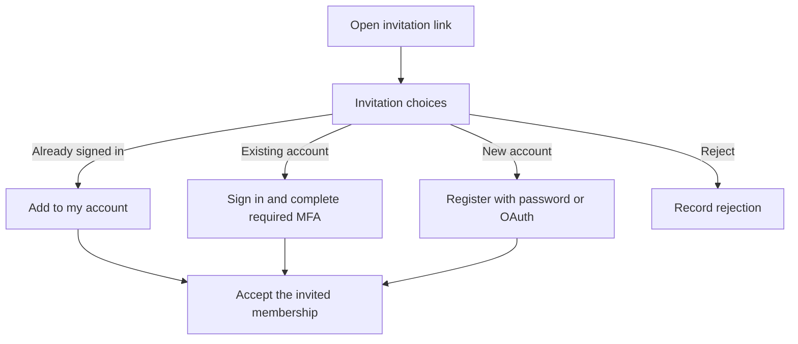

# Invitations

An invitation lets someone join your application through a link. In a multi-tenant application, they can join an organisation with an existing account or register a new account.

## Contents

- [Add invitations](#add-invitations)
- [Invite someone to an organisation](#invite-someone-to-an-organisation)
- [Accept or reject an invitation](#accept-or-reject-an-invitation)
- [Resend an invitation](#resend-an-invitation)
- [Revoke an invitation](#revoke-an-invitation)
- [Routes](#routes)
- [Registration customization](#registration-customization)
- [Edit the invitation actions](#edit-the-invitation-actions)

## Add invitations

For an existing Vouch `User` model:

```sh
bin/rails generate vouch:invitations User
bin/rails db:migrate
```

The generator adds:

- A migration with invitation fields and an inviter association on `User`.
- `Users::InvitationsController`, a send form and an acceptance choice page.
- `Users::InvitationMailer` and its email template.
- Routes for sending, resending, accepting, rejecting and revoking invitations.

The invitation is stored on the `User` record. The migration adds:

```ruby
change_table :users do |t|
  t.string :invitation_token, index: { unique: true }
  t.datetime :invitation_sent_at
  t.datetime :invitation_accepted_at
  t.datetime :invitation_rejected_at
  t.references :inviter, foreign_key: {to_table: :users}
  t.boolean :registration_required, default: false, null: false
end
```

`registration_required` distinguishes a newly invited person who still needs to choose a password from someone who already completed registration.

### Decide who can invite

Override the action, authorize the prepared `@invitation`, and call `super`:

```ruby
# app/controllers/users/invitations_controller.rb
class Users::InvitationsController < Vouch::InvitationsController
  def create
    # Authorize @invitation using your application's permissions.
    super
  end
end
```

Preparation builds an unsaved invitation. It does not create an account or send email before your action runs. Vouch performs the writes when you call `super`; a response such as `head :forbidden` prevents them even if you subsequently call `super`.

The generated `build_invited_account` method finds the credentials record by email or builds an unsaved account awaiting registration:

```ruby
# app/controllers/users/invitations_controller.rb
class Users::InvitationsController < Vouch::InvitationsController
  private

  def build_invited_account(identifier)
    email = identifier.to_s.strip.downcase
    User.find_by(email_address: email) || User.new(
      email_address: email,
      registration_required: true
    )
  end
end
```

For a multi-tenant application, this method targets the model holding the sign-in credentials, such as `Account`. Customize it if that model requires additional fields or uses another identifier. A pending account has no password until registration completes; an existing account keeps its credentials.

### Customize delivery

The generated controller connects the invitation event to the mailer:

```ruby
# In Users::InvitationsController
 on_invitation_token_generation do |identifier, invitation|
   Users::InvitationMailer.invitation(identifier, invitation).deliver_later
 end
```

Edit the generated mailer and template to change the message:

```ruby
# app/mailers/users/invitation_mailer.rb
class Users::InvitationMailer < ApplicationMailer
  def invitation(identifier, invitation)
    @invitee = invitation
    mail(to: identifier, subject: "Join our application")
  end
end
```

```erb
<%# app/views/users/invitation_mailer/invitation.text.erb %>
Accept your invitation: <%= accept_user_invitation_url(token: @invitee.invitation_token) %>
```

Each generated controller namespace has its own invitation mailer and template, so separate authentication scopes use their own acceptance links. The link uses your Action Mailer URL configuration.

If invitation creation fails, the controller redirects with an error alert instead of a success notice. Validation errors are shown when available; conflicts and cancelled writes use a general failure message.

### Offer the invitation form

The generator supplies `app/controllers/users/invitations_controller.rb` and `app/views/users/invitations/new.html.erb`. Link to that generated form:

```erb
<%= link_to "Invite someone", new_user_invitation_path %>
```

After the recipient opens the link:

- A new user completes registration and chooses a password. Vouch updates the invited record instead of creating a second user.
- An existing user accepts using their account. If that account is already signed in, Vouch reuses its session; otherwise they sign in and complete required MFA. Their password is unchanged.
- An expired or revoked link returns to sign-in with an error.

## Invite someone to an organisation

For the [multi-tenant setup](model-mapping.md) with `Account`, `User`, and `Organisation`:

```sh
bin/rails generate vouch:invitations User --account Account
bin/rails db:migrate
```

The generator normally infers the account from the configured `User` mapping. `--account Account` explicitly selects it when needed.

The invitation fields and inviter relationship shown above are added to `users`. The registration flag instead belongs to `accounts`:

```ruby
add_column :accounts, :registration_required, :boolean, default: false, null: false
```

The invitation is attached to the `User` membership. The generated lookup finds or creates its credentials `Account`, and Vouch creates the membership in the inviter's organisation. The `:user` scope contains `auth.invitations`; account registration remains on the parent scope:

```ruby
Vouch.routes(self) do |auth|
  auth.scope model: "Account" do
    auth.sessions
    auth.registrations

    auth.scope identity: "User", tenant: "Organisation" do
      auth.sessions
      auth.invitations
    end
  end
end
```

A new account chooses its password while retaining the invited membership and its organisation. An existing account accepts that membership using its existing login. Neither path creates another organisation.

Invitation acceptance and registration have [transactional hooks](#registration-customization) for accompanying records. Pending memberships are not ordinary sign-in choices: Vouch requires their valid invitation before granting access.

Tenant assignment is automatic through the configured associations. Override `assign_tenant_to_invitee(identity, inviter)` only when your invitation policy needs different assignment rules.

## Accept or reject an invitation

Opening the email link displays the generated choice page at `app/views/users/invitations/accept.html.erb`. Opening that GET page does not accept the invitation or start registration.



The choices are ordinary POST forms with Rails' request protection. You can edit the generated view without implementing their controllers.

- **Add to my account** appears when an account is signed in.
- **Sign in to an existing account** appears when signed out. Acceptance resumes after password or OAuth sign-in and any required MFA.
- **Register a new account** appears for an unfinished invitation while signed out. It completes the pending credentials account and retains the invited organisation. See [OAuth invitations](oauth.md#oauth-for-an-invitation) for provider registration.
- **Reject invitation** clears the link and records `invitation_rejected_at`. It preserves the account and marks the invited membership as rejected. Rejected memberships are not sign-in choices.

For multi-tenant invitations, choosing an existing account can move the pending membership from its unfinished placeholder to the authenticated account. Vouch does this only during successful acceptance, keeps the invitation's organisation, and refuses to move a membership owned by a registered account. It also refuses to add a second membership in the same organisation. The original placeholder is retained; Vouch does not delete an account as part of linking or rejection.

Invitations are checked again when they are consumed. An expired, revoked, accepted or replaced link cannot be reused. A host may send a new invitation after rejection with the normal create action.

`before_invitation_acceptance` and `after_invitation_acceptance` wrap acceptance inside its transaction. Rejection has its own `invitation_rejection` lifecycle, separate from the inviter's `invitation_revocation`. Their `before_commit_of_*` and `after_commit_of_*` callbacks use the [normal lifecycle ordering](sessions-and-hooks.md#lifecycle-hooks).

Membership-only impersonation cannot submit an acceptance choice. Full account impersonation follows the current account, subject to your action authorization.

The `accept`, `reject` and `destroy` actions accept the same response block as `create` and `resend`. Authorize the prepared `@invitation` in your action where your application requires it, then call `super`; Vouch still validates the token and account relationship.

## Resend an invitation

Creating another invitation for the same pending membership returns `:already_invited`. An existing joined membership returns `:already_joined`. Neither case sends another email or changes the invitation token.

Use the separate resend action to send a replacement link:

```erb
<%# Your invitation list view; the generator does not create an index page %>
<%= button_to "Resend invitation", resend_user_invitation_path,
  params: { invitation_token: invitation.invitation_token } %>
```

The controller loads `@invitation` through `revocable_invitations` before your action. It is `nil` when the token is unavailable. Resending rotates the token and restarts its expiry, so the previous link stops working. The inviter stays unchanged unless your action assigns a replacement:

```ruby
# app/controllers/users/invitations_controller.rb
class Users::InvitationsController < Vouch::InvitationsController
  def resend
    # Authorize @invitation using your application's permissions.
    @invitation.inviter = current_user if @invitation
    super
  end
end
```

Omit the assignment to retain the original inviter. Changing it also changes which user's default `revocable_invitations` relation contains the invitation.

Both `create` and `resend` accept a response block. You can display a resend link in your own error view instead of the default alert:

```ruby
# app/controllers/users/invitations_controller.rb
class Users::InvitationsController < Vouch::InvitationsController
  def create
    # Authorize @invitation using your application's permissions.
    super do |result|
      if result.metadata[:reason] == :already_invited
        @invitation = result.error.invitation
        render :already_invited, status: :conflict
      end
    end
  end
end
```

> Supply `app/views/users/invitations/already_invited.html.erb` when using this override. Rendering or redirecting in the block suppresses the default response; otherwise Vouch continues with its normal notice or alert.

## Revoke an invitation

```erb
<%= button_to "Revoke invitation", user_invitation_path, method: :delete,
  params: { invitation_token: invitation.invitation_token } %>
```

By default, a user may revoke their own pending invitations, within the selected organisation when applicable. Override `revocable_invitations` to return another authorized relation, for example to let an organisation administrator revoke invitations from colleagues:

```ruby
# In Users::InvitationsController
 def revocable_invitations
   return super unless current_user.admin?

   current_organisation.users.pending_invitation
 end
```

Revocation removes the invited membership in a multi-tenant setup. For a single-model user, it clears the invitation without deleting the user record.

## Routes

| Request | Helper | Action |
| --- | --- | --- |
| `GET /users/invitation/new` | `new_user_invitation_path` | `Users::InvitationsController#new` |
| `POST /users/invitation` | `user_invitation_path` | `Users::InvitationsController#create` |
| `POST /users/invitation/resend` | `resend_user_invitation_path` | `Users::InvitationsController#resend` |
| `GET /users/invitation/accept?token=…` | `accept_user_invitation_path(token: token)` | `Users::InvitationsController#accept` (choice page) |
| `POST /users/invitation/accept` | `accept_user_invitation_path` | `Users::InvitationsController#accept` (selected choice) |
| `POST /users/invitation/reject` | `reject_user_invitation_path` | `Users::InvitationsController#reject` |
| `DELETE /users/invitation` | `user_invitation_path` | `Users::InvitationsController#destroy` |

## Registration customization

`registration_required: true` means the credentials account has not finished registration. Accepting an invitation and choosing a password clears that flag. Other invitations for the same account then use its existing login, rather than asking for another password.

Use registration hooks for account-wide records and invitation-acceptance hooks for membership records:

```ruby
# In the generated registrations controller
 after_sign_up do |account, identity|
   Preferences.create!(account: account)
 end
```

```ruby
# In a concern included by the authentication controllers completing acceptance
 on_invitation_acceptance do |identity, account|
   MembershipPreferences.create!(user: identity)
 end
```

`Preferences` and `MembershipPreferences` are example models you supply. These callbacks run inside their operation's database transaction. Use [post-commit hooks](sessions-and-hooks.md#lifecycle-hooks) for external effects.

The generated lookup saves a pending account before sending its invitation. If your account requires profile fields at creation, supply them in `build_invited_account` or condition those validations on completed registration.

For custom flows, the model methods `invite`, `accept_invitation`, `reissue_invitation` and `reject_invitation` return `Vouch::Result`. Their `!` variants return the successful result or raise `Vouch::OperationFailed`, whose `result` retains the failure and underlying error.

## Edit the invitation actions

```sh
bin/rails generate vouch:eject users invitations
```

The endpoint actions become editable in your controller. Your existing lookup and authorization overrides remain in place. See [ejection](controllers.md#eject-a-controller).
