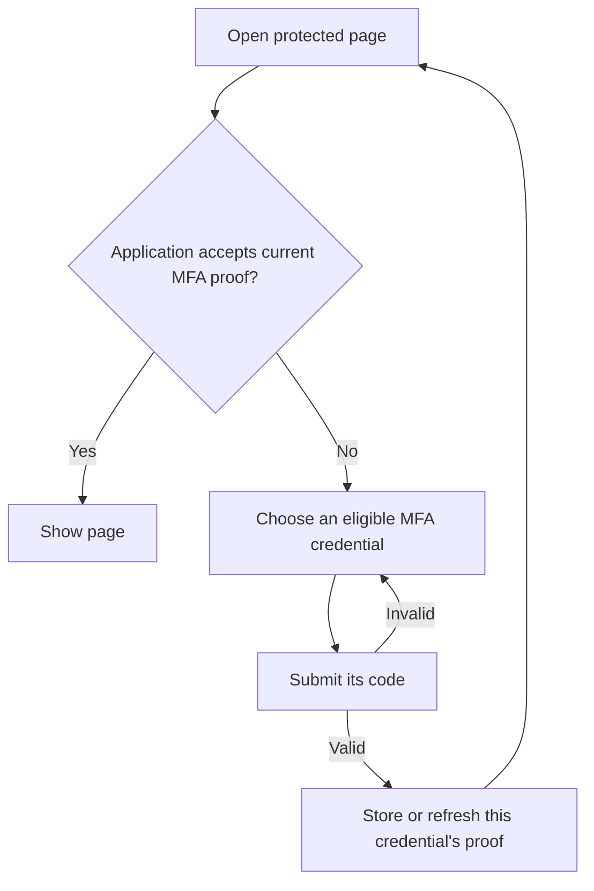

# Multi-factor authentication

Verification checks that someone controls a phone number or email address. It does not sign them in.

MFA challenges a verified credential after the person supplies their password. The credential model implements the challenge; its owner controls whether MFA is required for account sign-in. Your application can use [MFA evidence](authentication-policy.md#mfa-evidence-and-application-permissions) in its own permissions checks.

## Contents

- [Add phone-based MFA](#add-phone-based-mfa)
- [Sign in with MFA](#sign-in-with-mfa)
- [Verify more than one attribute](#verify-more-than-one-attribute)
- [Control factor availability](#control-factor-availability)
- [Request another MFA proof](#request-another-mfa-proof)
- [Other factors](#other-factors)
- [Edit challenge or enrollment actions](#edit-challenge-or-enrollment-actions)

## Add phone-based MFA

Starting with a Vouch `User` model:

```sh
bin/rails generate model Phone user:references e164:string
bin/rails generate vouch:two_factorable Phone --subject e164
bin/rails db:migrate
```

The first command creates `Phone` with `belongs_to :user`. Vouch uses that relationship to identify `User` as the credential owner. If the credential belongs to multiple models, specify the owner:

```sh
bin/rails generate vouch:two_factorable Phone --owner User --subject e164
```

Vouch adds:

- Verification and challenge fields to `phones`.
- `two_factor_enabled` to `users`, and the `has_many :phones` association.
- Verification and MFA concerns to `Phone`, with delivery methods for you to implement.
- Challenge and credential-management controllers under `app/controllers/users`.
- Their forms under `app/views/users`, and `auth.two_factor` routes.

The Rails model migration creates:

```ruby
create_table :phones do |t|
  t.references :user, null: false, foreign_key: true
  t.string :e164
  t.timestamps
end
```

Vouch's migrations add:

```ruby
add_column :users, :two_factor_enabled, :boolean, default: false, null: false
change_table :phones do |t|
  t.string :two_factor_nonce
  t.datetime :two_factor_enabled_at
  t.bigint :two_factor_failed_attempts, default: 0, null: false
  t.datetime :two_factor_locked_at
  t.datetime :two_factor_last_used_at
  t.string :verification_nonce
  t.datetime :verified_at
  t.bigint :verification_version, default: 0, null: false
  t.bigint :verification_attempts, default: 0, null: false
  t.datetime :verification_locked_at
  t.index :two_factor_enabled_at
  t.index :verified_at
end
```

`--subject e164` identifies the field whose value is verified. The generator adds this declaration:

```ruby
# app/models/phone.rb
self.verifiable_subject_attribute = :e164
```

Vouch clears verification and invalidates outstanding codes when that field changes. The replacement number must be verified before it can be used for MFA; changing the value back does not restore its earlier verification.

For a **multi-tenant application**, attach the phone to `Account`:

```sh
bin/rails generate model Phone account:references e164:string
bin/rails generate vouch:two_factorable Phone --owner Account --subject e164
```

The phone migration uses `account_id` instead of `user_id`, referencing `accounts`; the owner flag is added to `accounts`. Its challenge and management pages use the account routes.

For a custom controller namespace:

```sh
bin/rails generate vouch:two_factorable Phone --owner User --subject e164 --auth-scope user --controller-path portal
```

For model support and the same schema without pages:

```sh
bin/rails generate vouch:two_factorable Phone --owner User --subject e164 --model-only
```

### Connect your SMS delivery

The generator adds delivery methods that raise until you implement them. Replace their bodies with your SMS integration:

```ruby
# app/models/phone.rb
 def deliver_verification_code(code)
   SmsService.deliver(e164, "Your verification code is #{code}")
 end

 def deliver_two_factor_code(code)
   SmsService.deliver(e164, "Your sign-in code is #{code}")
 end
```

`SmsService` represents a service you implement using your SMS provider. Add phone normalization and validation to `Phone` as appropriate for the numbers you accept.

### Enroll a phone

The generator supplies `Users::TwoFactorCredentialsController` and its `index` and `new` views. Link to that management page:

```erb
<%= link_to "Manage two-factor authentication", user_two_factor_credentials_path %>
```

The generated flow saves a phone under the signed-in user, sends a verification code, and asks for that code. A successful verification enables the phone as a factor and enables MFA for the user. An incorrect code leaves the confirmation form available for another attempt.

The generated controller looks up phones through the authenticated owner’s association. Edit its permitted attributes and views to suit your forms.

## Sign in with MFA

For a user with MFA enabled:

1. They submit their email and password to the normal sign-in form.
2. Vouch asks them to choose one of their usable factors.
3. Selecting the phone sends a sign-in code. Submitting the correct code finishes sign-in and returns to the requested page or configured redirect.

A correct password alone does not establish the completed login. An incorrect code redisplays the challenge; an expired challenge needs a new code. Repeated failures can lock the factor. Disabled or unverified credentials cannot complete MFA.

When account MFA is required, the account is not signed in until that challenge succeeds. Organisation-specific access requirements belong to your application; see [MFA evidence](authentication-policy.md#mfa-evidence-and-application-permissions).

[Password reset](password-reset.md) does not disable this requirement. [Recovery codes](recovery-codes.md) can replace the MFA challenge after password authentication. Applications can enable account-owned codes, credential-owned codes, or both.

## Verify more than one attribute

When several fields together identify the recipient, configure them as an array:

```ruby
# app/models/email_address.rb
self.verifiable_subject_attribute = [:local_part, :domain]
```

Or generate that configuration with:

```sh
bin/rails generate vouch:two_factorable EmailAddress --subject local_part domain
```

This uses the same verification/challenge columns shown above on `email_addresses`; its owner receives the MFA flag. Both subject fields must exist on that model.

Both values are bound to the verification. Changing either invalidates existing codes and clears verification, including changing a value away and back. Attribute aliases are supported. The fields remain separate values, so combinations such as `ab` + `c` and `a` + `bc` are not treated as the same subject.

## Control factor availability

`phone.enable_two_factor!` enables an already verified factor. `user.enable_two_factor!` enables the account requirement and checks that a usable factor exists.

Calling `phone.enable_two_factor!` again leaves its enabled timestamp unchanged. Disabling the phone cancels its outstanding MFA challenge. Enabling it again starts a new enabled period: earlier challenges and recorded MFA proof no longer count, but an unchanged phone remains verified.

Removing or disabling the last usable factor is prevented by default: Vouch raises `Vouch::TwoFactorable::LastFactorRemoval`. To let removal disable the account’s MFA requirement, define this method on the credentials owner:

```ruby
# app/models/user.rb
 def two_factor_last_factor_removal_action(_credential)
   :disable
 end
```

Only choose that behavior when your application permits users to turn MFA off.

## Request another MFA proof

An already signed-in person can use the same challenge pages to verify another factor. Their account and membership sessions stay signed in. This is useful when your application's permissions require a particular authenticator or a more recent proof.



For example, a projects page can require a TOTP proof from the last fifteen minutes:

```ruby
# app/controllers/projects_controller.rb
class ProjectsController < ApplicationController
  before_action :authenticate_user!

  def show
    @project = current_user.projects.find(params[:id])
    # Apply your normal project authorization here.
    unless recent_totp?
      return redirect_to user_two_factor_challenges_path(return_to: request.fullpath)
    end
  end

  private

  def recent_totp?
    authentication_evidence(scope: :user).any? do |proof|
      proof["method"] == "two_factor" && proof["credential_method"] == "totp" &&
        Time.iso8601(proof["verified_at"]) >= 15.minutes.ago
    end
  end
end
```

This example assumes your application has `User#projects` and an enrolled authenticator named `totp`. In a multi-tenant setup, use the credentials scope's challenge route, such as `account_two_factor_challenges_path`, and read `authentication_evidence(scope: :account)`.

Filter the available factors in the generated challenge controller. `additional_authentication?` distinguishes this request from MFA during sign-in:

```ruby
# app/controllers/users/two_factor_challenge_controller.rb
class Users::TwoFactorChallengeController < Vouch::TwoFactorChallengeController
  def update(&response_handler)
    # Authorize @credential using your application's permissions system.
    super
  end

  private

  def eligible_credentials
    credentials = super
    return credentials unless additional_authentication?

    credentials.reject { |credential| credential.authentication_method.to_s != "totp" }
  end

  def recovery_owners
    additional_authentication? ? [] : super
  end
end
```

Apply your normal action authorization to the challenge controller. Vouch prepares `@account` before every action and `@credential` before `show`, `send_code` and `update`. The eligibility filter applies to lookup and submission as well as the displayed list. The recovery filter in this example excludes recovery codes because this particular page requires actual TOTP use.

Successful completion returns to `return_to`, which must be on the application's own origin. The page checks its permissions again. Only a GET destination is retained; Vouch does not replay a previous form submission.

| Request | Behavior while signed in |
| --- | --- |
| `GET /users/two_factor_challenges?return_to=/projects/1` | Starts the additional challenge or resumes its existing context. |
| `GET /users/two_factor_challenges/:id` | Issues or displays that credential's challenge. |
| `PATCH /users/two_factor_challenges/:id` | Checks the code and records proof. |
| `DELETE /users/two_factor_challenges` | Cancels the challenge and returns without signing out. |

The generated pages include a Cancel button. Failed codes, expiration and cancellation do not end the existing login. Refreshing the selector does not extend the active continuation's `pending_authentication_ttl`.

A successful challenge runs `on_two_factor_verification` once with the account, identity and credential, plus `evidence:` and `additional:` keywords. Recovery may have a nil credential; its evidence identifies the recovery owner. An additional challenge does not rerun sign-in callbacks.

> If passwordless sign-in used a phone or email record, that exact record remains excluded from MFA choices. Completing contact verification or enrolling a factor does not create MFA evidence.

## Other factors

### Authenticator apps (TOTP)

Vouch's generated phone flow delivers a code. An authenticator app instead calculates codes from a shared secret. You supply that credential model, its enrollment page and QR-code presentation, and implement `challenge!` and `verify_challenge(code, token:)` using a library such as `rotp`.

The [credential adapter contract](credential-adapter-contract.md) includes executable TOTP examples and checks replay prevention, lockout, expiry and cancellation. Its adapter tests belong in your test suite; they are not an enrollment controller.

## Edit challenge or enrollment actions

```sh
bin/rails generate vouch:eject users two_factor_challenge
bin/rails generate vouch:eject users two_factor_credentials
```

Both endpoints become locally editable while retaining generated enrollment and your overrides. See [ejection](controllers.md#eject-a-controller).
