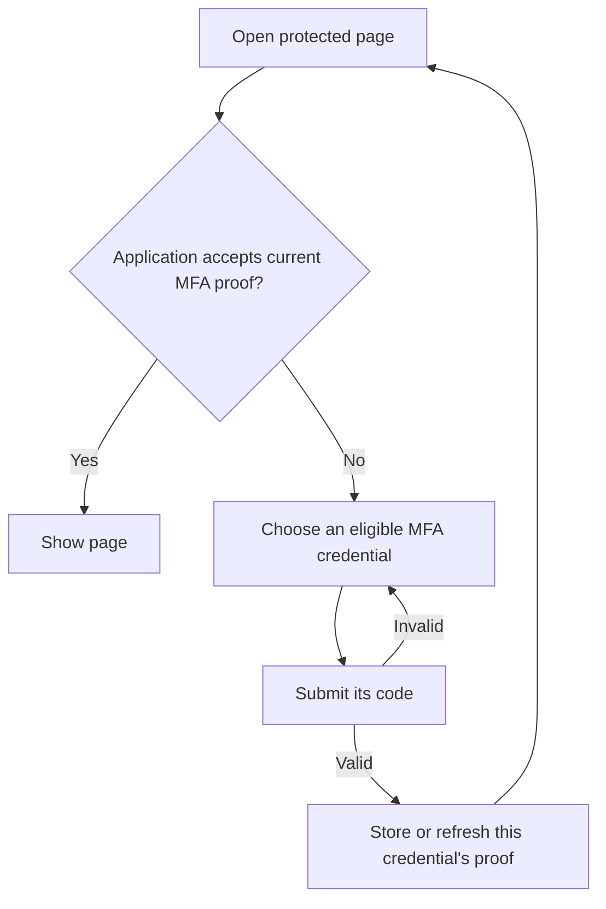

# Multi-factor authentication

Verification checks that someone controls a phone number or email address. It does not sign them in.

MFA challenges a verified credential after password or provider authentication. The credential model implements the challenge; its owner controls whether MFA is required for account sign-in. Your application can use [MFA evidence](authentication-policy.md#mfa-evidence-and-application-permissions) in its own permissions checks.

## Contents

- [Add phone-based MFA](#add-phone-based-mfa)
- [Add another credential type](#add-another-credential-type)
- [Resume enrollment or resend a code](#resume-enrollment-or-resend-a-code)
- [Sign in with MFA](#sign-in-with-mfa)
- [Configure challenge and management routes](#configure-challenge-and-management-routes)
- [Verify more than one attribute](#verify-more-than-one-attribute)
- [Control factor availability](#control-factor-availability)
- [Request approval for selected sign-ins](#request-approval-for-selected-sign-ins)
- [Request another MFA proof](#request-another-mfa-proof)
- [Other factors](#other-factors)
- [Edit challenge or enrollment actions](#edit-challenge-or-enrollment-actions)

## Add phone-based MFA

Start with a `Phone` model that belongs to the model your users sign in with. For example:

```ruby
# app/models/phone.rb
class Phone < ApplicationRecord
  belongs_to :user
  normalizes :e164, with: ->(value) { value.strip }
end
```

The `phones` table needs its owner reference and the phone number:

```ruby
create_table :phones do |t|
  t.references :user, null: false, foreign_key: true
  t.string :e164
  t.timestamps
end
```

> Persisted credentials require `created_at`: Vouch binds a challenge to the record’s creation time as well as its key, so reusing a deleted record’s key cannot make an old code valid.

Add MFA:

```sh
bin/rails generate vouch:two_factorable Phone --subject e164
bin/rails db:migrate
```

Vouch adds:

- Verification and challenge fields to `phones`.
- `two_factor_enabled` to `users`, and the `has_many :phones` association.
- Verification and MFA concerns to `Phone`, with delivery methods for you to implement.
- Challenge and credential-management controllers under `app/controllers/users`.
- Their forms under `app/views/users`.
- `auth.two_factor_challenges` and `auth.two_factor_credentials` routes.

Vouch's migrations add:

```ruby
add_column :users, :two_factor_enabled, :boolean, default: false, null: false
change_table :phones do |t|
  t.string :two_factor_nonce
  t.datetime :two_factor_enabled_at, index: true
  t.bigint :two_factor_failed_attempts, default: 0, null: false
  t.datetime :two_factor_locked_at
  t.datetime :two_factor_last_used_at
  t.string :verification_nonce
  t.datetime :verified_at, index: true
  t.bigint :verification_version, default: 0, null: false
  t.bigint :verification_attempts, default: 0, null: false
  t.datetime :verification_locked_at
end
```

`--subject e164` identifies the field being verified. You can omit it when the model already declares `verifiable_subject_attribute`. Enrollment requires that declaration. The generated model declarations connect the credential to its owner:

```ruby
# app/models/phone.rb
class Phone < ApplicationRecord
  include Vouch::Verifiable
  include Vouch::TwoFactorable

  belongs_to :user
  authentication_owner :user
  self.verifiable_subject_attribute = :e164
end
```

Changing the phone number clears verification and invalidates outstanding codes. The replacement number must be verified before use as an MFA method. Existing verification columns are retained; the migration adds only missing fields and indexes.

If the model has several `belongs_to` associations, select its authentication owner:

```sh
bin/rails generate vouch:two_factorable Phone --owner User --subject e164
```

For `belongs_to :user` and `belongs_to :organisation`, this adds `authentication_owner :user`. If several associations point to `User`, declare the one you intend before generating:

```ruby
# app/models/phone.rb
class Phone < ApplicationRecord
  belongs_to :holder, class_name: "User"
  belongs_to :added_by, class_name: "User"
  include Vouch::TwoFactorable
  authentication_owner :holder
end
```

> The declaration selects an existing Rails association. A missing association or an owner without `authenticates_with :two_factorable` produces a configuration error when the feature is used.

For a **multi-tenant application**, the owner is the model that holds sign-in credentials, such as `Account`. With `Phone belongs_to :account`, run:

```sh
bin/rails generate vouch:two_factorable Phone --owner Account --subject e164
```

This adds `authentication_owner :account` to `Phone` and the boolean `two_factor_enabled` column to `accounts`. The phone's verification and challenge fields remain the same as above. The generated challenge and management controllers use the account scope.

For a custom controller namespace:

```sh
bin/rails generate vouch:two_factorable Phone --owner User --subject e164 --auth-scope user --controller-path portal
```

To add the model declarations, owner association and migrations without generating controllers, views or routes:

```sh
bin/rails generate vouch:two_factorable Phone --owner User --subject e164 --model-only
```

### Connect your SMS delivery

The generator adds delivery methods that raise until you implement them. Replace their bodies with your SMS integration:

```ruby
# app/models/phone.rb
class Phone < ApplicationRecord
  def deliver_verification_code(code)
    SmsService.deliver(e164, "Your verification code is #{code}")
  end

  def deliver_two_factor_code(code)
    SmsService.deliver(e164, "Your sign-in code is #{code}")
  end
end
```

`SmsService` represents a service you implement using your SMS provider. Add phone normalization and validation to `Phone` as appropriate for the numbers you accept.

### Enroll a phone

The generator supplies `Users::TwoFactorCredentialsController` and its `index` and `new` views. Link to that management page:

```erb
<%= link_to "Manage two-factor authentication", user_two_factor_credentials_path %>
```

The generated flow saves a phone under the signed-in user, sends a verification code, and asks for that code. A successful verification and both MFA enablement writes commit together: the phone becomes a usable factor and MFA is enabled for the user. An incorrect code leaves the confirmation form available for another attempt.

The management page also lists existing phones. Choose **Continue verification** to finish adding a pending phone, or enable an already verified phone without sending another verification code. Removing a phone and enabling an existing one are separate actions from the sign-in challenge.

The generated controller looks up phones through the authenticated owner’s association. Before your `create`, `edit`, `send_code`, `update` or `destroy` override runs, `@credential` contains the new or selected phone. Edit its permitted attributes and views to suit your forms, and check permissions before calling `super`.

```ruby
# app/controllers/users/two_factor_credentials_controller.rb
class Users::TwoFactorCredentialsController < Vouch::TwoFactorCredentialsController
  def destroy
    # Authorize removal of @credential with your application's permissions.
    status = super
    redirect_to security_settings_path, notice: "Phone removed" if status == :ok
  end
end
```

`super` returns a status such as `:ok`, `:invalid` or `:cancelled`. The selected phone remains in `@credential`, including its validation errors. Your action can render, redirect or call `head` after the operation. Otherwise the generated controller's `default_render` supplies its normal response once your action finishes. A response issued before `super`, such as `head :forbidden`, prevents the mutation.

## Add another credential type

Run the generator for each credential model. For example, after adding phone MFA, add email MFA to an existing `Email` model:

```ruby
# app/models/email.rb
class Email < ApplicationRecord
  belongs_to :user
  normalizes :email_address, with: ->(value) { value.strip.downcase }
end
```

This example assumes an `emails` table with `user_id`, `email_address`, and timestamps. Generate its MFA support:

```sh
bin/rails generate vouch:two_factorable Email --subject email_address
bin/rails db:migrate
```

The migration adds the same verification and challenge fields shown for `phones` above, now on `emails`:

```ruby
change_table :emails do |t|
  t.string :two_factor_nonce
  t.datetime :two_factor_enabled_at, index: true
  t.bigint :two_factor_failed_attempts, default: 0, null: false
  t.datetime :two_factor_locked_at
  t.datetime :two_factor_last_used_at
  t.string :verification_nonce
  t.datetime :verified_at, index: true
  t.bigint :verification_version, default: 0, null: false
  t.bigint :verification_attempts, default: 0, null: false
  t.datetime :verification_locked_at
end
```

Existing fields and the owner's MFA column are retained. Replace the generated email delivery methods with your mailer calls.

The generated management page lists both phones and emails. Its **Add phone** and **Add email** links open forms for their respective subject fields. The forms permit only the selected model's `verifiable_subject_attribute` fields, including arrays of attributes.

For links in your own view, select the owner's association with `credential_kind`:

```erb
<%# app/views/security/show.html.erb %>
<%= link_to "Add phone", new_user_two_factor_credential_path(credential_kind: :phones) %>
<%= link_to "Add email", new_user_two_factor_credential_path(credential_kind: :emails) %>
<%= link_to "Continue email verification", edit_user_two_factor_credential_path(email, credential_kind: :emails) %>
```

With multiple types, every create, verification, resend, and removal request includes this selection. A missing or unknown type receives HTTP 404. Lookups stay within the signed-in owner's selected association, so a phone and email can safely share the same numeric ID.

The controller uses the MFA associations discovered by the authentication mapping. You can restrict enrollment types by overriding `credential_associations` in the generated controller:

```ruby
# app/controllers/users/two_factor_credentials_controller.rb
class Users::TwoFactorCredentialsController < Vouch::TwoFactorCredentialsController
  # Keep the generated enrollment actions.

  private

  def credential_associations
    auth_mapping.two_factor_credential_associations.select do |association|
      [:phones, :emails].include?(association.name)
    end
  end
end
```

> The generator retains existing controllers and views. The generated templates support additional credential types without replacement. If you customized them to use one association or fixed form fields, update those restrictions when adding another type. The generator lists retained files for review.

## Resume enrollment or resend a code

Someone who leaves the code-entry page can return through **Continue verification** on the management page. Opening that page does not send a message or change the current code.

Use **Resend verification code** if the code expired, was not received, or was requested in another browser session. Resending replaces the earlier code. It keeps the same phone record, which becomes usable for MFA only after verification succeeds.

For your own security-settings page, link to the generated form or submit a resend request:

```erb
<%# app/views/security/show.html.erb — phone belongs to the signed-in user %>
<%= link_to "Continue verification", edit_user_two_factor_credential_path(phone, credential_kind: :phones) %>
<%= button_to "Resend verification code", send_code_user_two_factor_credential_path(phone, credential_kind: :phones), method: :post %>
```

The generated controller limits enrollment-code delivery to five requests per signed-in owner every three minutes. Initial enrollment and resends share that limit; excess requests receive HTTP 429. Edit its Rails `rate_limit` declaration to change the limit or response:

```ruby
# app/controllers/users/two_factor_credentials_controller.rb
class Users::TwoFactorCredentialsController < Vouch::TwoFactorCredentialsController
  rate_limit to: 5, within: 3.minutes, only: %i[create send_code],
    by: -> { Vouch::RecordKey.to_param(current_account) }, name: "enrollment_delivery"

  # Keep the generated enrollment actions below.
end
```

> Replace the existing declaration when changing this limit. Rails stores its counters in the controller's cache store; use a shared store when running multiple application processes. `Vouch::RecordKey.to_param` keeps the owner key consistent for both ordinary and composite primary keys.

Resending does not reset failed verification attempts or bypass a verification lockout. Requests for another user's phone return HTTP 404, and already verified phones return to the management page without sending a code.

## Sign in with MFA

For a user with MFA enabled:

1. They submit their email and password to the normal sign-in form.
2. Vouch asks them to choose one of their usable factors.
3. Selecting the phone sends a sign-in code. Submitting the correct code finishes sign-in and returns to the requested page or configured redirect.

A correct password alone does not establish the completed login. An incorrect code redisplays the challenge; an expired challenge needs a new code. Repeated failures can lock the factor. Disabled or unverified credentials cannot complete MFA.

When account MFA is required, the account is not signed in until that challenge succeeds. Organisation-specific access requirements belong to your application; see [MFA evidence](authentication-policy.md#mfa-evidence-and-application-permissions).

[Password reset](password-reset.md) does not disable this requirement. [Recovery codes](recovery-codes.md) can replace the MFA challenge after password authentication. Applications can enable account-owned codes, credential-owned codes, or both.

## Configure challenge and management routes

The MFA generator adds two declarations to the credentials scope:

```ruby
# config/routes.rb
Rails.application.routes.draw do
  Vouch.routes(self) do |auth|
    auth.scope model: "User" do
      auth.sessions
      auth.registrations
      auth.two_factor_challenges
      auth.two_factor_credentials
    end
  end
end
```

| Declaration | Pages and actions |
| --- | --- |
| `auth.two_factor_challenges` | Select an authenticator, send and check its code, cancel a challenge, or use a recovery code. |
| `auth.two_factor_credentials` | List, enroll, resume verification, resend enrollment codes, enable and remove authenticators. |
| `auth.recovery_codes` | View the remaining recovery-code count and generate a replacement set. Added by the [recovery-code generator](recovery-codes.md). |

Each declaration accepts `controller:`, `paths:` and `path_names:`. For example, change the challenge-selection URL and helper while retaining the other challenge actions:

```ruby
# config/routes.rb, inside auth.scope model: "User"
auth.two_factor_challenges(
  controller: "users/two_factor_challenge",
  paths: {
    index: "mfa"
  },
  path_names: {
    index: :choose_mfa
  }
)
```

The selector is now `GET /users/mfa`, reached with `choose_mfa_path`. The generated forms and Vouch's redirects follow these names. `paths:` values are relative to the scope URL; `path_names:` values are complete helper names without `_path` or `_url`.

Actions can share a default helper: challenge `index` and `destroy`, for example, both use `user_two_factor_challenges_path`. When giving those actions different URLs, supply distinct `path_names`, as above. See the [complete route table](controllers.md#routes) for actions, URLs and defaults.

## Verify more than one attribute

When several fields together identify the recipient, configure them as an array:

```ruby
# app/models/email_address.rb
class EmailAddress < ApplicationRecord
  self.verifiable_subject_attribute = [:local_part, :domain]
end
```

Or generate that configuration with:

```sh
bin/rails generate vouch:two_factorable EmailAddress --subject local_part domain
```

This uses the same verification/challenge columns shown above on `email_addresses`; its owner receives the MFA flag. Both subject fields must exist on that model.

Both values are bound to the verification. Changing either invalidates existing codes and clears verification, including changing a value away and back. Attribute aliases are supported. The fields remain separate values, so combinations such as `ab` + `c` and `a` + `bc` are not treated as the same subject.

## Control factor availability

`phone.enable_two_factor!` enables an already verified factor. `user.enable_two_factor!` enables the account requirement and checks that a usable factor exists.

These operations also have normal methods: `enable_two_factor`, `disable_two_factor`, `challenge`, `verify_challenge` and `record_two_factor_use`. They return a `Vouch::Result` so your controller can handle an unsuccessful operation. Their bang versions return the same successful result and raise `Vouch::OperationFailed` on failure; `error.result` retains the record and underlying error. Configuration and delivery errors propagate.

Calling `phone.enable_two_factor!` again leaves its enabled timestamp unchanged. Disabling the phone cancels its outstanding MFA challenge. Enabling it again starts a new enabled period: earlier challenges and recorded MFA proof no longer count, but an unchanged phone remains verified.

Your application decides who may remove or disable a factor. Removing the last one does not turn off the account's login MFA preference. If that preference remains enabled, the next sign-in still requires MFA; offer recovery codes or a replacement-factor journey according to your application's permissions.

For example, authorize deletion before calling Vouch's action. The account preference changes only when your code explicitly calls `user.disable_two_factor!`.

```ruby
# app/controllers/users/two_factor_credentials_controller.rb
class Users::TwoFactorCredentialsController < Vouch::TwoFactorCredentialsController
  def destroy
    # Check whether this person may remove the selected authenticator.
    super
  end
end
```

## Request approval for selected sign-ins

Your application can require fresh proof for an unfamiliar device or another sign-in condition. [Sign-in approval](sign-in-approval.md) uses these challenge pages and one verified contact selected by your application. The contact can remain unenrolled for ordinary MFA.

Ordinary MFA still applies when required. If its proof also satisfies approval, Vouch completes both requirements with one challenge.

## Request another MFA proof

An already signed-in person can use the same challenge pages to verify another factor. Their account and membership sessions stay signed in. This is useful when your application's permissions require a particular authenticator or a more recent proof.



For example, a projects page can require a TOTP proof from the last fifteen minutes:

```ruby
# app/controllers/projects_controller.rb
class ProjectsController < ApplicationController
  before_action :authenticate_user!

  def show
    @project = current_user.projects.find(params[:id])
    # Apply your normal project authorization here.
    unless recent_totp?
      return redirect_to user_two_factor_challenges_path(return_to: request.fullpath)
    end
  end

  private

  def recent_totp?
    authentication_evidence(scope: :user).any? do |proof|
      proof["method"] == "two_factor" && proof["credential_method"] == "totp" &&
        Time.iso8601(proof["verified_at"]) >= 15.minutes.ago
    end
  end
end
```

This example assumes your application has `User#projects` and an enrolled authenticator named `totp`. In a multi-tenant setup, use the credentials scope's challenge route, such as `account_two_factor_challenges_path`, and read `authentication_evidence(scope: :account)`.

Filter the available factors in the generated challenge controller. `additional_authentication?` distinguishes this request from MFA during sign-in:

```ruby
# app/controllers/users/two_factor_challenge_controller.rb
class Users::TwoFactorChallengeController < Vouch::TwoFactorChallengeController
  def update
    # Authorize @credential using your application's permissions system.
    super
  end

  private

  def eligible_credentials
    credentials = super
    return credentials unless additional_authentication?

    credentials.reject { |credential| credential.authentication_method.to_s != "totp" }
  end

  def recovery_owners
    additional_authentication? ? [] : super
  end
end
```

Apply your normal action authorization to the challenge controller. Vouch prepares `@user` for this single-model scope before every action and `@credential` before `show`, `send_code` and `update`. An `:account` credentials scope exposes `@account` instead. The eligibility filter applies to lookup and submission as well as the displayed list. The recovery filter in this example excludes recovery codes because this particular page requires actual TOTP use.

Successful completion returns to `return_to`, which must be on the application's own origin. The page checks its permissions again. Only a GET destination is retained; Vouch does not replay a previous form submission.

| Request | Behavior while signed in |
| --- | --- |
| `GET /users/two_factor_challenges?return_to=/projects/1` | Starts the additional challenge or resumes its existing context. |
| `GET /users/two_factor_challenges/:id` | Issues or displays that credential's challenge. |
| `PATCH /users/two_factor_challenges/:id` | Checks the code and records proof. |
| `DELETE /users/two_factor_challenges` | Cancels the challenge and returns without signing out. |

The generated pages include a Cancel button. Failed codes, expiration and cancellation do not end the existing login. Refreshing the selector does not extend the active continuation's `pending_authentication_ttl`.

To customize a challenge response, inspect the status after `super`. For additional MFA, successful completion has already stored `@authentication_evidence` and retains the destination in `@return_to`:

```ruby
# app/controllers/users/two_factor_challenge_controller.rb
class Users::TwoFactorChallengeController < Vouch::TwoFactorChallengeController
  def update
    status = super
    if status == :ok && additional_authentication?
      redirect_to @return_to, notice: "Authenticator confirmed."
    end
  end
end
```

Unhandled outcomes use Vouch's `default_render`. During sign-in, successful code verification may return `:pending` with `@next_step == :selection` when a membership still needs selecting; that is not a completed membership login. An invalid code returns `:invalid`, and an exhausted attempt budget returns `:locked`.

A successful challenge runs `on_two_factor_verification` once with the account, identity and credential, plus `evidence:` and `additional:` keywords. Recovery may have a nil credential; its evidence identifies the recovery owner. An additional challenge does not rerun sign-in callbacks.

> If passwordless sign-in used a phone or email record, that exact record remains excluded from MFA choices. Completing contact verification or enrolling a factor does not create MFA evidence.

## Other factors

### Authenticator apps (TOTP)

Vouch's generated phone flow delivers a code. An authenticator app instead calculates codes from a shared secret. You supply that credential model, its enrollment page and QR-code presentation, and implement `challenge` and `verify_challenge(code, token:)` using a library such as `rotp`.

The [credential adapter contract](credential-adapter-contract.md) includes executable TOTP examples and checks replay prevention, lockout, expiry and cancellation. Its adapter tests belong in your test suite; they are not an enrollment controller.

## Edit challenge or enrollment actions

```sh
bin/rails generate vouch:eject users two_factor_challenge
bin/rails generate vouch:eject users two_factor_credentials
```

Both endpoints become locally editable while retaining generated enrollment and your overrides. See [ejection](controllers.md#eject-a-controller).
