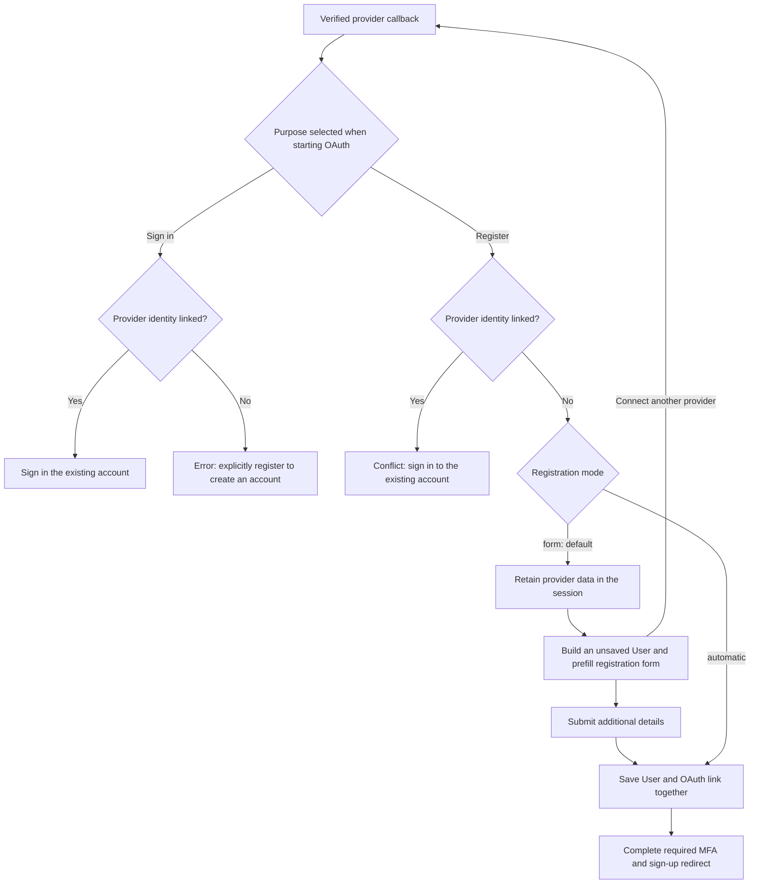

# OAuth sign-in

## Contents

- [Add GitHub sign-in](#add-github-sign-in)
- [Choose registration behavior](#choose-registration-behavior)
- [Connect a provider to an existing account](#connect-a-provider-to-an-existing-account)
- [Prefill and extend the registration form](#prefill-and-extend-the-registration-form)
- [Connect several providers during registration](#connect-several-providers-during-registration)
- [Expired providers and reconnection](#expired-providers-and-reconnection)
- [OAuth for an invitation](#oauth-for-an-invitation)
- [Retain additional provider data](#retain-additional-provider-data)
- [Handle automatic registration failures](#handle-automatic-registration-failures)
- [Customize callback responses](#customize-callback-responses)
- [Routes and custom controllers](#routes-and-custom-controllers)
- [Existing OAuth storage](#existing-oauth-storage)

## Add GitHub sign-in

Start with the [standard Vouch setup](../README.md#install-and-generate-a-login), then generate GitHub sign-in:

```sh
bin/rails generate vouch:omniauth User --provider github
```

The generator adds:

- An `OauthIdentity` model and migration, associated with `User`.
- The OAuth feature and association on `User`.
- `Users::OmniAuthsController` and its callback routes.
- `config/initializers/vouch_omniauth_github.rb`, which connects the GitHub strategy to those routes.

The ordinary `User` migration creates:

```ruby
create_table :oauth_identities do |t|
  t.references :user, null: false, foreign_key: true
  t.string :provider, null: false
  t.string :uid, null: false
  t.json :auth_data
  t.timestamps

  t.index [:provider, :uid], unique: true
end
```

An existing compatible table or migration is reused; the generator does not overwrite an existing model. For an existing table, it checks the required columns and reports incompatible storage.

For storage and model support only:

```sh
bin/rails generate vouch:omniauth User --model-only
```

This still generates or reuses the OAuth model and migration and configures the owner association. It omits the callback controller, routes and provider initializer. Running the normal generator for a second provider reuses that storage and adds its provider initializer.

Choose the model that owns authentication:

- **Single-tenant:** use the command above for `User`.
- **Multi-tenant:** use `bin/rails generate vouch:omniauth Account --provider github` when `Account` owns the password and `User` is a membership.

Install the provider packages before starting the application or running migrations with the generated initializer:

```sh
bundle add omniauth omniauth-github omniauth-rails_csrf_protection
```

Add GitHub's client ID and secret to Rails credentials using the keys read by the generated initializer:

```yaml
github:
  client_id: your-client-id
  client_secret: your-client-secret
```

On Rails 8.2+, the initializer uses [`Rails.app.creds.require`](https://edgeapi.rubyonrails.org/classes/Rails/Application.html#method-i-creds), which also reads environment variables. On Rails 8.1 it uses `Rails.application.credentials.dig`. Register `/users/auth/github/callback` as the callback path with GitHub, or `/accounts/auth/github/callback` for the multi-tenant command.

```sh
bin/rails db:migrate
```

Start sign-in with a POST button. OmniAuth handles this request and redirects to GitHub:

```erb
<%# app/views/users/sessions/new.html.erb %>
<%= button_to "Sign in with GitHub", "/users/auth/github",
  params: { purpose: :sign_in }, data: { turbo: false } %>
```

When GitHub returns, OmniAuth verifies the response and passes it to Vouch. Sign-in succeeds only when that provider identity is already connected to an account. An unknown identity produces an error asking the person to register. A matching email alone does not connect a provider to an existing account; that account must sign in before linking it. Omitting `purpose` also means sign-in.

## Choose registration behavior

Start registration explicitly from your registration page:

```erb
<%# app/views/users/registrations/new.html.erb %>
<%= button_to "Register with GitHub", "/users/auth/github",
  params: { purpose: :register }, data: { turbo: false } %>
```

An unlinked provider identity opens your registration form by default. Edit the generated `auth.oauth_callbacks` declaration when changing the mode; keep any generated `controller:` option rather than adding a second declaration:

```ruby
# Inside the User scope in config/routes.rb
auth.oauth_callbacks registration: :form
```



For an application where provider data supplies everything needed to register, opt into automatic registration instead:

```ruby
# config/routes.rb, update the existing credentials-scope declaration
auth.oauth_callbacks registration: :automatic
```

The controller method `oauth_registration_required?` remains an override point for a decision that varies by request. Returning `true` chooses the form; returning `false` attempts automatic creation. Its default follows the route setting.

For example, if your model validations fully describe the required registration fields:

```ruby
# app/controllers/users/omni_auths_controller.rb
class Users::OmniAuthsController < Vouch::OmniAuthsController
  private

  def oauth_registration_required?
    !@account.valid?
  end
end
```

Vouch has already applied the verified provider information to the unsaved account before this decision. This example attempts automatic creation when that record validates and shows the form otherwise; creation can still fail later because of a uniqueness race or a related record. Keep the default form mode if registration must collect consent or other inputs beyond model validations.

## Connect a provider to an existing account

Use a separate linking button on your account settings page:

```erb
<%# app/views/accounts/settings/show.html.erb %>
<%= button_to "Connect GitHub", "/users/auth/github",
  params: { purpose: :link }, data: { turbo: false } %>
```

Vouch binds this request to the account, scope and signed-in session that started it. Switching accounts, signing out and back in, or entering impersonation before the callback returns prevents linking. A provider identity already attached to the same account is harmless; one owned by another account cannot be reassigned.

During full account impersonation, a linking request started from the impersonated account can add a provider to that account. Membership-only impersonation cannot link providers. Sign-in and registration callbacks are also refused while impersonating. Your action authorization can further restrict who may link providers.

> Vouch retains the purpose in session state associated with the provider request. Callback URL parameters cannot turn registration into linking or change the destination account. OmniAuth's own provider response and state validation remain required.

## Prefill and extend the registration form

With `:form`, the callback builds an unsaved account and OAuth identity, applies the provider information, and stores the resulting account attributes and provider proof in the Rails session. `RegistrationsController#new` restores the account without applying the mapping again. The generated model-bound form displays its values and omits password fields. Neither the new account nor its OAuth link exists in the database yet.

The default mapping prefills `email_address` when the provider supplies it. OAuth-only accounts have a null password digest and sign in through their linked provider. To also prefill an existing `name` attribute:

```ruby
# app/models/user.rb
class User < ApplicationRecord
  def apply_oauth_registration(oauth_identity, auth_hash:)
    super
    self.name = auth_hash.info.name if name.blank?
  end
end
```

Add the input inside the generated form:

```erb
<%# app/views/users/registrations/new.html.erb, inside form_with %>
<%= form.label :name %>
<%= form.text_field :name %>
```

Permit edits to that value:

```ruby
# app/controllers/users/registrations_controller.rb
class Users::RegistrationsController < Vouch::RegistrationsController
  private

  def account_params
    super.merge(params.require(:user).permit(:name))
  end
end
```

On submission, Vouch restores the retained attributes and applies permitted form values. Validation errors re-render that record with its errors. A successful submission saves the account and OAuth links in the same transaction. Mapping does not run again during rendering or submission, so later edits are preserved. The provider and UID come from the retained callback, never from editable form fields.

For multi-tenant registration, that transaction also saves the organisation and membership constructed by your registration methods. See [registration construction](registration.md#construct-records-transactionally) for the organisation name input and shared construction methods. After registration and required authentication steps, [the sign-up redirect](registration.md#send-people-to-onboarding) can send the person to onboarding.

## Connect several providers during registration

With form registration, another `purpose: :register` provider button returns to the same pending registration. Each new provider identity is verified separately and passed to `apply_oauth_registration` on the restored account. The default mapping fills an empty email; your override can fill, replace or combine other attributes. All connected providers become sign-in methods after the final submission. Vouch does not choose a primary provider.

Connect providers before entering the remaining form details. A provider button does not submit unsaved browser inputs to the registration controller. Custom multistep forms must retain their own edited fields before leaving for a provider; Vouch does not supply a wizard or infer permitted fields from that POST.

`pending_oauth_providers` returns entries such as:

```ruby
[{ provider: "github", uid: "123", expired: false }]
```

Up to five pending provider identities are retained. A conflict with another account leaves previous successful connections intact. The final transaction saves one account and all its provider links, or rolls everything back if a link has become unavailable.

The pending registration is tied to its authentication session and invitation. Changing either prevents those provider proofs from being applied to another registration.

Vouch limits the serialized pending registration to 2 KiB. Exceeding that limit returns `:registration_too_large` and preserves the previous state. For server-backed sessions, a controller can increase this budget:

```ruby
# app/controllers/users/omni_auths_controller.rb
class Users::OmniAuthsController < Vouch::OmniAuthsController
  private

  def oauth_registration_byte_limit
    8.kilobytes
  end
end
```

Apply the same override in the registrations controller when its form retains additional fields.

> This budget covers Vouch's registration data. Other session values and cookie encryption also consume space when using Rails' cookie session store.

## Expired providers and reconnection

Each proof expires independently after `pending_authentication_ttl`; [configure that timeout here](authentication-policy.md#pending-sign-in-timeout). Adding another provider does not extend an earlier proof. Expired entries remain visible through `pending_oauth_providers`, and registration returns an invalid result with `metadata[:reason] == :expired_providers` and the affected entries in `metadata[:providers]`.

Reconnect the same provider identity explicitly:

```erb
<%# app/views/users/registrations/new.html.erb %>
<%= button_to "Reconnect GitHub", "/users/auth/github",
  params: { purpose: :register, reconnect_uid: "123" }, data: { turbo: false } %>
```

If the provider returns another UID, Vouch reports `:identity_mismatch` and keeps the original entry. A successful reconnect refreshes that proof without reapplying profile attributes. Adding another UID is a separate registration provider request without `reconnect_uid`.

You can provide a removal action using the normal controller helper:

```ruby
# config/routes.rb — inside Rails.application.routes.draw
delete "registration/providers", to: "users/registration_providers#destroy", as: :registration_provider

# app/controllers/users/registration_providers_controller.rb
class Users::RegistrationProvidersController < Vouch::RegistrationsController
  def destroy
    result = remove_pending_oauth_identity(provider: params.require(:provider), uid: params.require(:uid))
    redirect_to new_user_registration_path, status: :see_other,
      alert: ("Provider was not found." unless result.ok?)
  end
end
```

This removes only the matching pending identity, not a saved account's provider link. Removing the final provider preserves form attributes but requires a real alternative, such as entering a password or reconnecting a provider, before registration can finish. The host chooses the messages and layout for these controls.

## OAuth for an invitation

A new invitee may connect one or more providers before submitting the registration form. Vouch completes the existing pending account, saves those provider links, and accepts the invited membership in one transaction. It keeps the invitation's organisation and does not construct another tenant or membership. Automatic registration follows the same ownership rules.

An existing account uses the invitation's sign-in/acceptance path. Connecting additional providers afterward uses `purpose: :link`. A provider already connected to another account cannot silently merge that account with an invited placeholder.

## Retain additional provider data

Vouch retains the provider, UID, and the `email`, `name`, and `image` profile fields during the form step. For another value, extend serialization before the callback redirects to registration. This example assumes `User` already has a `provider_nickname` column:

```ruby
# app/controllers/users/omni_auths_controller.rb
class Users::OmniAuthsController < Vouch::OmniAuthsController
  private

  def serialize_oauth(auth_hash)
    super.tap do |payload|
      payload["info"]["nickname"] = auth_hash.info.nickname.to_s.first(100)
    end
  end
end
```

The default parser reconstructs the retained hash. Map it onto the unsaved record:

```ruby
# app/models/user.rb
class User < ApplicationRecord
  def apply_oauth_registration(oauth_identity, auth_hash:)
    super
    self.provider_nickname = auth_hash.info.nickname if provider_nickname.blank?
  end
end
```

To let the person change it, add `form.text_field :provider_nickname` inside the generated form and permit it in `account_params`, following the `name` example above. Without that input, the mapped value is saved unchanged after successful registration.

You can also set custom attributes on the unsaved OAuth identity supplied to the mapping method. For example, if `OauthIdentity` has a `provider_nickname` column:

```ruby
# app/models/user.rb
class User < ApplicationRecord
  def apply_oauth_registration(oauth_identity, auth_hash:)
    super
    oauth_identity.provider_nickname = auth_hash.info.nickname
  end
end
```

Vouch retains those custom identity attributes and saves them with the link after successful registration. Provider, UID, ownership and token fields are taken from the verified flow rather than these edits. The serialization override above is still needed if `nickname` must remain available in later lifecycle callbacks.

Keep retained session data small. Provider access tokens are not retained by the default serializer; an application that needs later provider API access should store them in its own encrypted storage.

## Handle automatic registration failures

An automatic signup can fail because a required attribute is missing, an email is already registered, or a registration callback cancels it. Vouch rolls back failed record creation and redirects with an alert. It returns to the same-origin page that initiated the provider request when available, otherwise to sign-in. It does not silently switch to the registration form.

The initiation page is captured in the Rails session when the POST to the provider starts. The provider callback's referrer is not used. This return path affects registration failure only; successful registration keeps its normal sign-up destination.

Expected failures call `oauth_registration_failed`. Override it to add reporting while retaining the redirect:

```ruby
# app/controllers/users/omni_auths_controller.rb
class Users::OmniAuthsController < Vouch::OmniAuthsController
  private

  def oauth_registration_failed(reason:, error: nil)
    Rails.logger.info("OAuth registration failed: #{reason}")
    Rails.error.report(error, handled: true) if error
    super
  end
end
```

Reasons are `:validation`, `:conflict`, `:cancelled`, or `:aborted`. If registration commits but subsequent sign-in fails, Vouch keeps the account and redirects to sign-in with a creation notice and failure alert. This is separate from a failed registration form submission, which redisplays validation errors. Expected failures are not automatically sent to an error reporter. Unexpected exceptions propagate through Rails error handling. Provider authentication failure itself uses the `failure` action and returns to sign-in.

## Customize callback responses

Override `callback` and pass a block to `super` to handle an outcome. The operation has already run when the block receives its `Vouch::Result`:

```ruby
# app/controllers/users/omni_auths_controller.rb
class Users::OmniAuthsController < Vouch::OmniAuthsController
  def callback
    super do |result|
      if result.metadata[:reason] == :not_registered
        redirect_to new_user_registration_path, alert: "Create an account to connect this provider."
      end
    end
  end
end
```

Rendering or redirecting in the block replaces Vouch's response. Doing neither keeps the normal redirect. `failure` accepts the same block for provider authentication failures. Errors raised by your response block propagate to Rails; Vouch does not treat them as failed registration attempts.

| Outcome | Result |
| --- | --- |
| Signed in, linked, or completed automatic registration | `ok?`; `value` is the account or linked OAuth identity |
| Continue to registration | `pending?`, `metadata[:next_step] == :registration` |
| Complete MFA or select a membership | `pending?`, with `:two_factor` or `:selection` as the next step |
| Invalid request, conflicting provider or failed validation | `invalid?`; inspect `metadata[:reason]` and `error` |
| A lifecycle callback cancels the operation | `cancelled?` |
| Account saved but subsequent sign-in failed | A failed result with `metadata[:committed] == true`; do not create another account |

`metadata[:operation]` distinguishes `:sign_in`, `:link` and `:registration` after request validation. Request failures occur before an operation starts. Expected persistence failures retain their original exception in `error`.

## Routes and custom controllers

| Request | Handler | Purpose |
| --- | --- | --- |
| `POST /users/auth/:provider` | OmniAuth middleware | Start sign-in, registration or linking with `purpose`. |
| `GET /users/auth/:provider/callback` | `Users::OmniAuthsController#callback` | Link, sign in, or start registration after provider verification. |
| `GET /users/auth/failure` | `Users::OmniAuthsController#failure` | Return to sign-in after provider failure. |

The callback helpers are `user_oauth_callback_path(provider: :github)` and `user_oauth_failure_path`. Rename these with `path_names:` or change their URLs with `paths:`; see [route customization](controllers.md#routes).

Providers that POST their callback require that HTTP method on the callback route:

```ruby
# config/routes.rb, update the existing credentials-scope declaration
auth.oauth_callbacks callback_methods: [:get, :post]
```

For custom paths, configure the same callback address in the provider dashboard, OmniAuth middleware, and Vouch's `callback_path:` option. `failure_path:` changes the failure endpoint. These route options do not configure the provider strategy or its credentials.

Edit the generated subclass for small overrides. To take ownership of the complete callback controller:

```sh
bin/rails generate vouch:eject users omni_auths
```

See [controller ejection](controllers.md#eject-a-controller) for the generated implementation file.

## Existing OAuth storage

Vouch identifies a provider login by the pair `provider` and `uid`. A matching email alone never authorizes linking. For a differently shaped identity model, override its `find_from_omniauth` lookup and `oauth_attributes` mapping together, maintaining uniqueness for the provider's stable identifier.

For an already-configured OAuth owner, an existing polymorphic association can be mapped explicitly. Keep `include Vouch::Authenticatable` and `authenticates_with :omniauthable` on the owner; an existing identity model must include `Vouch::OAuthIdentity::Concern`:


```ruby
# app/models/oauth_identity.rb
class OauthIdentity < ApplicationRecord
  include Vouch::OAuthIdentity::Concern
  belongs_to :oauthable, polymorphic: true
end

# app/models/account.rb
class Account < ApplicationRecord
  has_many :oauth_identities, as: :oauthable, dependent: :destroy
end
```

```ruby
# Inside Vouch.routes in config/routes.rb
auth.scope model: "Account", associations: {omniauthable: :oauth_identities, oauth_account: :oauthable} do
  auth.sessions
  auth.registrations
  auth.oauth_callbacks
end
```

This describes existing storage; the ordinary generator creates a concrete owner foreign key.
