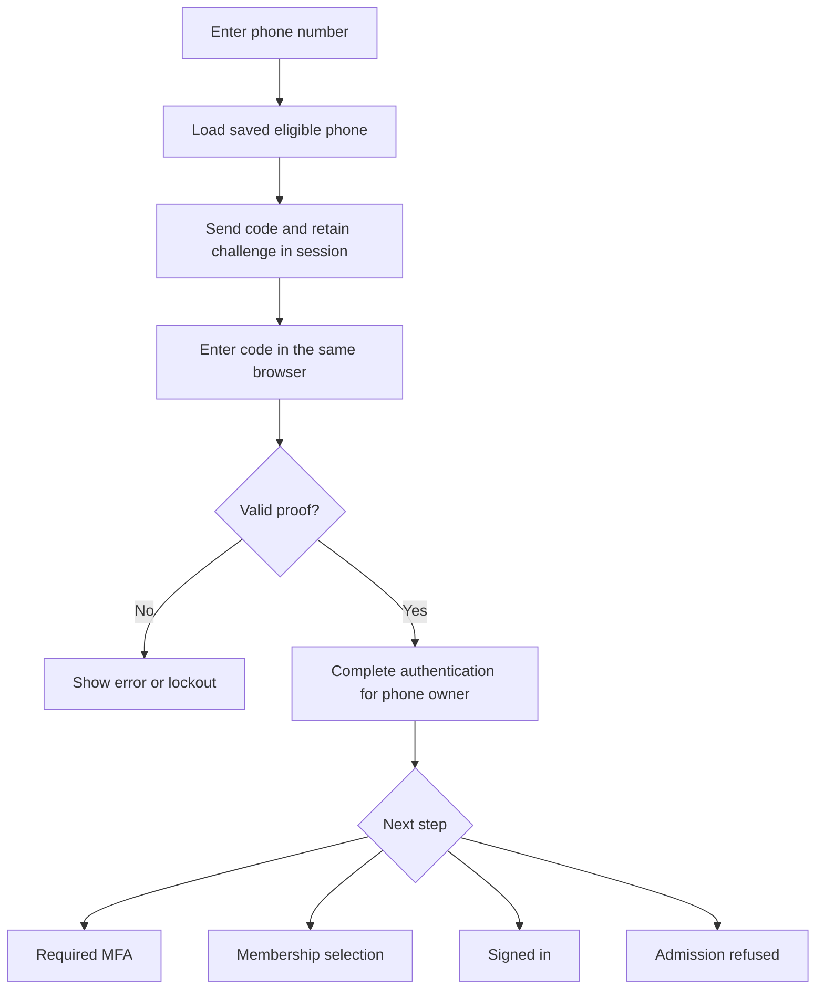

# Passwordless sign-in

Send a one-time code to a saved phone or email credential instead of asking for a password. Vouch checks the code and supplies authentication completion; your application supplies the contact lookup, delivery integration and sign-in pages.

This is a code-and-session flow in the initiating browser. It is not a portable sign-in link. [Contact verification](verification.md) proves an address when adding it; passwordless sign-in proves a saved credential for authentication.

## Contents

- [Add passwordless codes](#add-passwordless-codes)
- [Provide the sign-in endpoints](#provide-the-sign-in-endpoints)
- [Provide the forms](#provide-the-forms)
- [Continue through MFA and membership selection](#continue-through-mfa-and-membership-selection)
- [Failures and model operations](#failures-and-model-operations)

## Add passwordless codes

This example builds on a `Phone` configured with [contact verification](verification.md#add-code-verification), belonging to your sign-in model. It contains a normalized `e164` number and a `created_at` timestamp. The verified-only lookup is an application choice; the passwordless generator does not add verification fields.

```sh
bin/rails generate vouch:magic_linkable Phone --subject e164
bin/rails db:migrate
```

The generator adds:

- A sign-in nonce, attempt counter and lock timestamp to the existing table.
- `Vouch::MagicLinkable` and the identifying-field declaration to `Phone`.
- A delivery method for your SMS integration.

It preserves an existing subject declaration or delivery method. It does not generate an owner association, routes, controllers, mailer or forms.

```ruby
change_table :phones do |t|
  t.string :sign_in_nonce
  t.bigint :sign_in_attempts, default: 0, null: false
  t.datetime :sign_in_locked_at
end
```

The example below uses an existing, verified phone with a concrete owner:

```ruby
# app/models/phone.rb
class Phone < ApplicationRecord
  include Vouch::Verifiable
  include Vouch::MagicLinkable
  belongs_to :user

  self.verifiable_subject_attribute = :e164
  normalizes :e164, with: ->(value) { value.strip }
  validates :e164, presence: true, uniqueness: true

  def deliver_verification_code(code)
    SmsService.deliver(e164, "Your verification code is #{code}")
  end

  def deliver_sign_in_code(code)
    SmsService.deliver(e164, "Your sign-in code is #{code}")
  end
end
```

> `SmsService` is your application's delivery integration. The controller below assumes it defines `SmsService::DeliveryError` for delivery failures; use the corresponding exception from your integration. Supply your application's phone normalization rules.

This lookup assumes each number identifies one credential. Add the matching unique index if that is your application's rule:

```ruby
# db/migrate/20261001000000_make_phone_login_unique.rb
class MakePhoneLoginUnique < ActiveRecord::Migration[8.1]
  def change
    change_table :phones do |t|
      t.index :e164, unique: true
    end
  end
end
```

Applications with shared contact numbers need a different, unambiguous account lookup. Do not select an arbitrary owner from duplicate contacts.

- **Single-tenant:** the example phone belongs to `User`, which owns sign-in credentials.
- **Multi-tenant:** associate the phone with whichever model owns sign-in credentials, for example `Account`. Put the endpoint under that credentials scope and call `complete_sign_in(phone.account, ...)`; membership selection follows the requested authentication scope.

## Provide the sign-in endpoints



The controller belongs under the scope's usual namespace, so `Users` selects the `User` authentication scope:

```ruby
# config/routes.rb
Rails.application.routes.draw do
  resource :phone_sign_in, controller: "users/phone_sessions",
    only: [:new, :create, :show, :update]
end
```

```ruby
# app/controllers/users/phone_sessions_controller.rb
class Users::PhoneSessionsController < ApplicationController
  include Vouch::Authentication
  only_allow_unauthenticated_access

  rate_limit to: 10, within: 3.minutes, only: [:create, :update]

  def new
  end

  def create
    session.delete(:phone_sign_in)
    submitted = Phone.new(params.require(:phone).permit(:e164))
    phone = Phone.verified.find_by(e164: submitted.e164)
    unless phone
      return redirect_to new_phone_sign_in_path, alert: "Unable to send a sign-in code"
    end

    result = phone.issue_sign_in_code
    unless result.ok?
      return redirect_to new_phone_sign_in_path, alert: "Unable to send a sign-in code"
    end

    session[:phone_sign_in] = { "id" => phone.id, "token" => result.token }
    redirect_to phone_sign_in_path
  rescue SmsService::DeliveryError => error
    Rails.error.report(error)
    redirect_to new_phone_sign_in_path, alert: "The code could not be sent. Please try again"
  end

  def show
    redirect_to new_phone_sign_in_path unless session[:phone_sign_in]
  end

  def update
    pending = session[:phone_sign_in]
    return redirect_to new_phone_sign_in_path unless pending

    phone = Phone.verified.find_by(id: pending.fetch("id"))
    unless phone
      session.delete(:phone_sign_in)
      return redirect_to new_phone_sign_in_path, alert: "Please request another code"
    end

    result = phone.verify_sign_in_code(params.require(:code), token: pending.fetch("token"))
    unless result.ok?
      if result.locked?
        session.delete(:phone_sign_in)
        return redirect_to new_phone_sign_in_path, alert: "Too many attempts. Please try again later"
      end
      flash.now[:alert] = "The code is invalid, expired, or could not be accepted"
      return render :show, status: :unprocessable_entity
    end

    session.delete(:phone_sign_in)
    outcome = complete_sign_in(phone.user, method: :passwordless, signed_in_via: phone)
    case outcome
    when :signed_in
      redirect_after_authentication
    when :needs_two_factor
      redirect_to two_factor_challenges_path
    when :needs_selection
      redirect_to select_path
    when :no_identity
      redirect_to new_phone_sign_in_path, alert: "There are no memberships available for this login"
    when :denied
      redirect_to new_phone_sign_in_path, alert: "Unable to sign in. Please try again"
    end
  end
end
```

`new` and `show` render the forms below. `show` does not verify anything; the PATCH request does. Vouch's generated MFA and membership-selection endpoints handle the later redirects when those features are configured.

> The short rate-limit example uses your configured Rails cache. Use a shared atomic store and add subject/delivery limits appropriate to your channel; [the verification guide](verification.md#protect-delivery-and-code-submission) explains Rails' options and fail-closed cache handling.

For nonstandard or composite primary keys, replace the example's `phone.id` storage with `Vouch::RecordKey.serialize(phone)` and restore with `Vouch::RecordKey.find(Phone.verified, pending.fetch("id"))`.

## Provide the forms

```erb
<%# app/views/users/phone_sessions/new.html.erb %>
<%= form_with url: phone_sign_in_path, scope: :phone do |form| %>
  <%= form.label :e164, "Phone number" %>
  <%= form.telephone_field :e164, autocomplete: "tel", required: true %>
  <%= form.submit "Send sign-in code" %>
<% end %>
```

```erb
<%# app/views/users/phone_sessions/show.html.erb %>
<%= form_with url: phone_sign_in_path, method: :patch do |form| %>
  <%= form.label :code, "Sign-in code" %>
  <%= form.text_field :code, autocomplete: "one-time-code", required: true %>
  <%= form.submit "Sign in" %>
<% end %>
<%= link_to "Request another code", new_phone_sign_in_path %>
```

Your layout displays the flash messages using its normal markup. An email implementation follows the same flow with an email model, permitted address and mailer delivery.

## Continue through MFA and membership selection

A correct passwordless code proves the first factor. It does not directly establish a Warden session. `complete_sign_in` checks the owner's admission policy and continues through required MFA and identity selection before publishing authentication.

Passing `signed_in_via: phone` retains an account-bound reference to the exact credential used. That record is excluded from initial MFA and later additional-MFA challenges. Another record containing the same phone number or inbox is not automatically treated as equivalent.

If no independent eligible factor exists, the MFA page cannot complete that requirement with the primary credential. It shows the missing-factor state and offers supported recovery when available. The application must provide an appropriate enrollment/recovery path; the first-factor proof does not silently bypass MFA. The retained first-factor reference is separate from [MFA evidence](authentication-policy.md).

A credentials-only multi-tenant login authenticates its credentials scope. Entering a protected membership page then starts that membership's selection. If a membership login was requested first, Vouch resumes the requested flow after authentication.

## Failures and model operations

| Normal operation | Bang alternative | Success value |
| --- | --- | --- |
| `phone.issue_sign_in_code` | `phone.issue_sign_in_code!` | Challenge token. |
| `phone.verify_sign_in_code(code, token: token)` | `phone.verify_sign_in_code!(code, token: token)` | Verified credential. |

Normal methods return `Vouch::Result` for invalid proof, lockout and cancelled writes. Bang methods raise `Vouch::OperationFailed` for those outcomes and otherwise return the same successful result. Unexpected delivery/database exceptions propagate; rescue your delivery service's known exception at the endpoint, rather than broadly hiding application errors.

Issuance requires a saved credential. A newly issued code replaces the previous sign-in challenge; incorrect verification increments that credential's sign-in attempts. Successful consumption clears the nonce atomically, so replay cannot authenticate again. Cancelled persistence leaves the code retryable. Changing a declared subject field revokes an outstanding sign-in code, including models that use `MagicLinkable` without `Verifiable`.

See [custom authentication completion](advanced-custom-authentication.md) for other first-factor protocols, and [the optional credential test contract](credential-adapter-contract.md) for custom MFA adapters.
