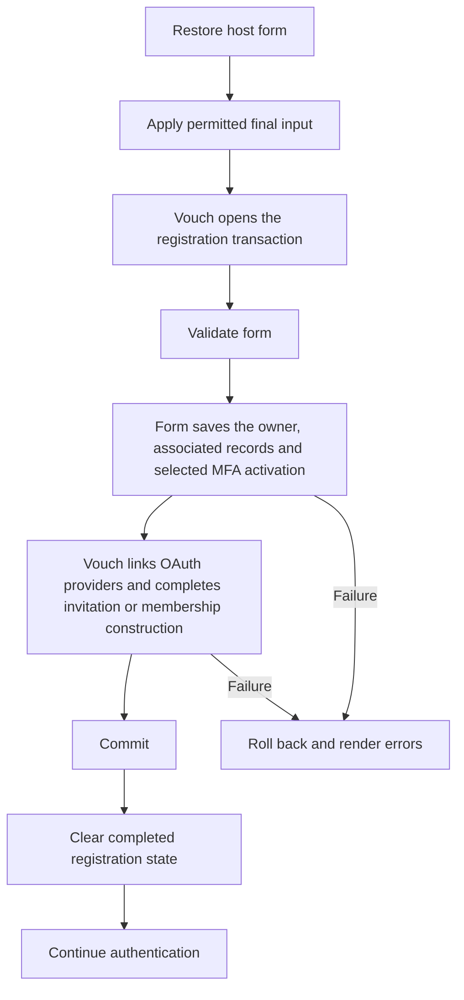
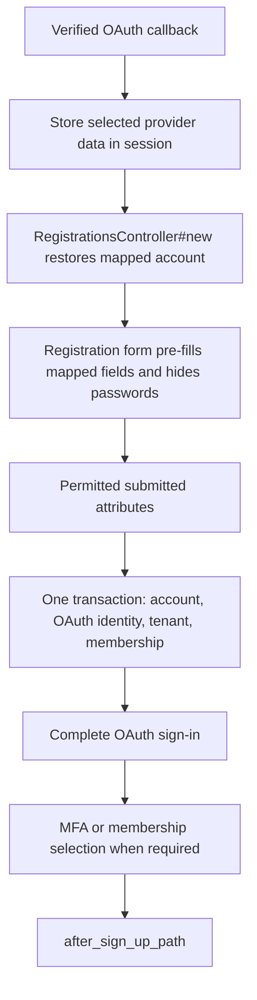

# Registration

## Contents

- [Standard registration](#standard-registration)
- [Custom registration forms](#custom-registration-forms)
- [Accounts without passwords](#accounts-without-passwords)
- [Construct records transactionally](#construct-records-transactionally)
- [OAuth registration continuation](#oauth-registration-continuation)
- [Invitation registration](#invitation-registration)
- [Registration responses](#registration-responses)
- [Send people to onboarding](#send-people-to-onboarding)

## Standard registration

After the [standard setup](../README.md#install-and-generate-a-login), Vouch supplies `Users::RegistrationsController` and `app/views/users/registrations/new.html.erb`:

1. `GET /users/sign_up` builds an unsaved `User` and displays the form.
2. `POST /users/sign_up` assigns permitted fields and saves the record inside a transaction.
3. Invalid fields redisplay the form with errors and HTTP 422. Successful creation continues to sign-in or any required MFA.

In this guide, “account” means the model holding sign-in credentials; it can be `User`, `Account`, or another name. Add ordinary fields to the form and `account_params`; see [sign-in customization](sign-in-customization.md#customize-registration-fields).

## Custom registration forms

Declare a form when registration needs associated records or several pages. The generated registration flow remains available without a custom form.

```ruby
# app/controllers/application_controller.rb
class ApplicationController < ActionController::Base
  registration_form SignupForm
end
```

This declaration applies to the registration and OAuth controllers through inheritance. A controller can declare another form for its scope. A class name string also works: `registration_form "SignupForm"`.

Vouch passes the credentials record positionally. Use `initialize(user)` for a `User` model or `initialize(account)` for an `Account` model. Vouch supplies the existing pending record during invited registration.

| Form method | Contract |
| --- | --- |
| `.new(record)` | Construct the form around the supplied record. |
| `.deserialize(data, record)` | Restore serialized data around that same record. |
| `serialize` | Return JSON-compatible session data. |
| `assign_attributes(attributes)` | Apply permitted input. |
| `valid?`, `errors` | Validate and expose errors through an Active Model-compatible interface. |
| `save!` or `save` | Save the supplied record and associated records inside Vouch's transaction. |

Vouch prefers `save!` when available. A bang method may return `nil` on success. Returning `false` cancels registration. A non-bang `save` must return a truthy value on success. Validation exceptions roll back registration and render its errors. Vouch does not require an accessor named `account` or `user`.

### Define the form

This example assumes `User` has one `Profile` with a `timezone` attribute and many `Phone` records. Each phone supports verification and MFA, as described in the [verification](verification.md) and [MFA](mfa.md) guides.

```ruby
# app/forms/signup_form.rb
class SignupForm
  include ActiveModel::Model
  include ActiveModel::Attributes

  attr_reader :user, :profile, :phones
  attribute :enable_mfa, :boolean, default: false

  delegate :email_address, :email_address=,
    :password, :password=,
    :password_confirmation, :password_confirmation=, to: :user
  delegate :timezone, :timezone=, to: :profile

  def initialize(user)
    super()
    @user = user
    @profile = user.profile || user.build_profile
    @phones = []
  end

  def self.deserialize(data, user)
    form = new(user)
    form.email_address = data["email_address"] if data.key?("email_address")
    form.timezone = data["timezone"]
    form.enable_mfa = data["enable_mfa"]
    form.expired_phone = data["expired_phone"]

    data.fetch("phones", []).each do |state|
      phone = Phone.new
      result = phone.restore_verification_state(state)
      if result.ok?
        form.phones << phone
      else
        form.expired_phone = true
      end
    end
    form
  end

  attr_accessor :expired_phone
  validate do
    errors.add(:phones, "must be verified again") if expired_phone
  end

  def serialize
    {
      "email_address" => email_address,
      "timezone" => timezone,
      "enable_mfa" => enable_mfa,
      "expired_phone" => expired_phone,
      "phones" => phones.map(&:serialize_verification_state)
    }
  end

  def save!
    user.save!
    profile.save!
    phones.each do |phone|
      phone.user = user
      phone.save!
      phone.enable_two_factor! if enable_mfa
    end
    user.enable_two_factor! if enable_mfa
  end
end
```

The example applies one MFA choice to all included phones. Your form can store a separate selection for each credential. Email records follow the same verification export/restore pattern with your `Email` model.

The form reads provider-mapped fields directly from `user`. OAuth updates therefore appear in the form and its next serialized version. Vouch cannot synchronize an independently cached `@email_address` or another virtual field automatically.

> Keep passwords, submitted codes and plaintext authenticator secrets out of `serialize`. Use `serialize_verification_state` for temporary verified records. Restoring that state checks its model, subject and original expiry. Copying a submitted `verified_at` does not establish verification.

The example retains an expired-phone flag and blocks completion until your form clears it after re-verification or explicit removal. A fuller form can track each expired contact separately. Do not silently accept an expired proof. If deserialization raises `Vouch::OperationFailed`, Vouch displays a verification error and preserves the stored draft.

### Permit input and render errors

The form can use its own parameter root and fields. Override `registration_form_params` in the generated controller:

```ruby
# app/controllers/users/registrations_controller.rb
class Users::RegistrationsController < Vouch::RegistrationsController
  private

  def registration_form_params
    allowed = [:timezone, :password, :password_confirmation]
    allowed << :email_address unless invitation_registration?
    params.fetch(:signup, ActionController::Parameters.new).permit(*allowed)
  end
end
```

Without this override, Vouch uses the normal `account_params` or invitation parameters. Vouch exposes the form as `@registration_form` and through the `registration_form` helper. Update the generated view to use it:

```erb
<%# app/views/users/registrations/new.html.erb %>
<% @registration_form.errors.full_messages.each do |message| %>
  <p><%= message %></p>
<% end %>

<%= form_with model: @registration_form, scope: :signup,
      url: vouch_route_path(:registrations, :create) do |form| %>
  <% unless invitation_registration? %>
    <%= form.email_field :email_address %>
  <% end %>
  <%= form.text_field :timezone %>
  <% unless oauth_registration? %>
    <%= form.password_field :password %>
    <%= form.password_field :password_confirmation %>
  <% end %>
  <%= form.submit "Create account" %>
<% end %>
```

A failed associated-record save adds its messages to the form's base errors. Your form can instead catch that validation exception and attach errors to particular fields.

### Save intermediate steps

Custom actions access the same form with `registration_form`. `save_registration_form` serializes it without saving database records and returns a `Vouch::Result`.

```ruby
# app/controllers/users/signup_steps_controller.rb
class Users::SignupStepsController < Vouch::RegistrationsController
  def update
    form = registration_form
    allowed = [:timezone]
    allowed << :email_address unless invitation_registration?
    form.assign_attributes(params.require(:signup).permit(*allowed))
    result = save_registration_form

    if result.ok?
      redirect_to new_registration_path
    else
      render json: { error: result.metadata[:reason] }, status: :unprocessable_entity
    end
  rescue Vouch::RegistrationFormError
    clear_registration_form
    redirect_to new_registration_path, alert: "Your registration expired or changed. Please start again."
  end
end
```

```ruby
# config/routes.rb — alongside Vouch.routes
Rails.application.routes.draw do
  namespace :users do
    resource :signup_step, only: :update
  end
end
```

Submit your intermediate page to `users_signup_step_path`. Save the current fields before leaving the page for an OAuth request. The OAuth callback restores this form before applying the new provider's data.

`save_registration_form!` raises `Vouch::OperationFailed` when the draft cannot be saved. `clear_registration_form` removes the stored draft and the current request's form instance. Use it for an explicit restart.

The draft belongs to one authentication scope, session context and invitation. It expires after `pending_authentication_ttl`, measured from its first save. Saving another step does not extend that expiry. A changed context or expired draft requires a restart.

A scope has one draft per session. Tabs share it. Applications requiring separate drafts per tab must manage that distinction before using this shared registration continuation.

### Attach verified contacts

Keep the preparation and rate-limit callbacks from your [temporary verification controller](verification.md#verify-before-saving). Its success handler can put the verified record into the registration form:

```ruby
# app/controllers/users/temporary_verifications_controller.rb
# Relevant override in your configured temporary verification controller.
class Users::TemporaryVerificationsController < Vouch::TemporaryVerificationsController
  def update
    super do |result|
      next unless result.ok?

      form = registration_form
      form.phones.reject! { |phone| phone.verification_subject_key == @verifiable.verification_subject_key }
      form.phones << @verifiable
      saved = save_registration_form

      if saved.ok?
        forget_temporary_verification
        redirect_to new_registration_path
      else
        render json: { error: saved.metadata[:reason] }, status: :unprocessable_entity
      end
    end
  rescue Vouch::RegistrationFormError
    clear_registration_form
    redirect_to new_registration_path, alert: "Your registration expired or changed. Please start again."
  end
end
```

Only remove temporary verification state after the form retains it successfully. For signed-in contact management, attach the verified record to the authorized owner instead. The host controller chooses that destination.

For TOTP, your enrollment adapter must confirm a code and retain trustworthy enrollment state. The form then saves and enables that credential inside its `save!` method. Vouch's generic temporary verification controller does not implement a TOTP enrollment adapter. Enrollment is not authentication evidence.

### Finish in one transaction



Vouch runs form validation and persistence inside its registration transaction. The existing lifecycle hooks still run. All participating records must use the credentials model's writing connection.

For a multi-tenant application, keep `build_tenant` and `build_identity` for Vouch's mapped organisation and membership. The form owns additional records and their input. Those builders can read `registration_form` when they need its fields. Invited registration uses the existing membership and skips both builders.

Form validation failure, an OAuth-link conflict, or a later invitation/MFA failure rolls back the registration writes together. If registration commits but sign-in fails, Vouch keeps the account and redirects to sign-in with the creation and sign-in failure messages.

### Session capacity

The form envelope has a default limit of 2 KB. This is separate from the OAuth context limit. Exceeding it returns `:registration_too_large` and preserves the previous stored draft.

Encrypted verification state can exceed a cookie session's available space even for one credential. Use a suitable server-side session store for larger forms:

```ruby
# config/initializers/session_store.rb
Rails.application.config.session_store :cache_store
```

Configure a shared cache store with the lifetime and availability your application needs. Registration still creates no unfinished business records in the database.

Increase the form limit after selecting the session store:

```ruby
# app/controllers/application_controller.rb
class ApplicationController < ActionController::Base
  registration_form SignupForm

  private

  def registration_form_byte_limit
    32.kilobytes
  end
end
```

The form controls which permitted attributes it serializes. Vouch rejects live objects and common plaintext secret fields, but cannot identify sensitive values hidden under arbitrary names.

## Accounts without passwords

Ordinary registration requires a chosen password. OAuth registration can instead save a verified provider identity in the same transaction, leaving `password_digest` null. An invitation may also create a pending account without either method; completing its registration still requires a usable sign-in method.

The generated model retains Rails password validations and makes only the absent-password case optional:

```ruby
# app/models/user.rb — relevant declarations from the generated model
class User < ApplicationRecord
  has_secure_password

  validate do
    errors.delete(:password, :blank) if password_digest.nil? && password.nil?
  end
end
```

Rails still checks password confirmation, BCrypt's byte limit and a supplied `password_challenge`. Registration rejects an explicitly submitted empty password; the OAuth form omits password fields entirely. Vouch separately checks the sign-in method when completing registration, rather than requiring a provider association before the account can be saved inside the transaction.

> Existing models keep their own validations. To support OAuth-only accounts or passwordless invitation placeholders, make the digest column nullable and use the optional-absence validation above after `has_secure_password`. Keep any stricter password rules your application requires. A null digest never authenticates a password.

For another verified registration method, the host can override `registration_authentication_available?(account, oauth:)` in its registration controller. Only return true after your registration flow has established the supported alternative; ordinary contact verification and MFA enrollment are not first-factor authentication.

## Construct records transactionally

For multi-tenant registration, Vouch saves records in this order inside one transaction:

1. Save the credential account.
2. Call `build_tenant(account)` and save the returned organisation.
3. Call `build_identity(account, tenant:)` and save the returned membership.

Return unsaved records from custom builders so Vouch controls persistence and rollback. The account passed to a builder, and the tenant passed to `build_identity`, have already been saved inside the open transaction; they are not yet committed. With one model, the default identity is the account itself, so no second record is created. GET registration does not invoke these builders.

All records requiring atomic persistence must share the credential model's writing database connection. A transaction cannot roll back writes to another database.

The generated tenant has no application-specific attributes. The following customization assumes you added a `name` column to `Organisation` and want to collect it during registration.

```ruby
# app/controllers/concerns/provisions_organisation.rb
module ProvisionsOrganisation
  extend ActiveSupport::Concern

  private

  def build_identity(account, tenant:)
    tenant.users.build(account: account)
  end
end
```

Move the generated controller's local `build_identity` method into this concern when adopting it; a local method otherwise takes precedence over an included concern. Include the same concern in registrations and, when using automatic OAuth registration, in the callback controller. This keeps construction consistent for ordinary registration, form OAuth continuation, and the explicit automatic OAuth opt-in:

```ruby
# app/controllers/accounts/registrations_controller.rb
class Accounts::RegistrationsController < Vouch::RegistrationsController
  include ProvisionsOrganisation

  private

  def build_tenant(_account)
    Organisation.new(params.require(:organisation).permit(:name))
  end
end

# app/controllers/accounts/omni_auths_controller.rb
class Accounts::OmniAuthsController < Vouch::OmniAuthsController
  include ProvisionsOrganisation

  private

  def build_tenant(account)
    Organisation.new(name: "#{account.email_address}'s organisation")
  end
end
```

Automatic registration has no submitted organisation form. The example above chooses a default name; use `registration: :form` when the person must choose it.

The registration form owns the tenant input. Keep it separate from account parameters:

```erb
<%# app/views/accounts/registrations/new.html.erb — inside the registration form %>
<% unless invitation_registration? %>
  <%= text_field_tag "organisation[name]", params.dig(:organisation, :name), required: true %>
<% end %>
```

For form OAuth registration, `RegistrationsController#create` restores the account attributes, assigns only permitted form fields, and then creates the account, OAuth identities, tenant, and membership in that transaction. A validation failure renders `app/views/accounts/registrations/new.html.erb` again with errors and no new persisted account/link. Provider and UID never come from form fields. See [multiple providers](oauth.md#connect-several-providers-during-registration) for separate proof expiry and reconnection.

## OAuth registration continuation

Configure OAuth callback registration with `:form` (the default) when a new provider identity needs fields that OAuth does not supply:

```ruby
# config/routes.rb, inside the credentials scope
auth.oauth_callbacks registration: :form
```

After an explicit OAuth registration request is verified, Vouch applies the provider data to the unsaved account and retains its attributes and provider proof in the session. `RegistrationsController#new` restores those values and pre-fills the form without applying the mapping again. No new account or provider link is saved yet. The generated form uses `oauth_registration?` to omit password fields while a valid provider proof supplies the sign-in method.

On submit, Vouch combines the mapped account fields with permitted form fields and creates the account and OAuth link in one transaction. In a multi-tenant setup, that transaction also includes the organisation and membership. It then continues through MFA and membership selection before redirecting. Validation failures re-render the form. Provider/UID data comes from protected session state, never submitted fields.

The default mapping uses the provider email when supplied and leaves the password absent. Add another mapped form value through the account model:

```ruby
# app/models/account.rb
class Account < ApplicationRecord
  def apply_oauth_registration(oauth_identity, auth_hash:)
    super
    self.name = auth_hash.info.name if name.blank?
  end
end
```



## Invitation registration

A new invitee completes the pending account and accepts the existing membership. Vouch reuses the invitation's organisation and does not call `build_tenant` or `build_identity`. The generated form shows the invited email as text, since registration cannot change the invitation recipient.

Use `invitation_registration?` to hide your tenant-creation fields, as shown above. Put work needed for both ordinary registration and new-invitee registration in a registration hook. Register the same callback for OAuth account creation when you offer OAuth:

```ruby
# app/controllers/accounts/registrations_controller.rb
class Accounts::RegistrationsController < Vouch::RegistrationsController
  after_sign_up :create_preferences
  after_oauth_account_creation :create_preferences

  private

  def create_preferences(account, *)
    Preferences.create!(account: account)
  end
end
```

> `Preferences` is an example application model. For automatic OAuth registration, add the same declarations and method to the OAuth controller or share them in a concern. Each callback runs inside the registration transaction; a failed write rolls back the account completion and invitation acceptance together. An existing account accepting another membership does not register again; use an invitation-acceptance hook for work needed on every accepted invitation.

## Registration responses

Vouch commits the account and related records before signing the person in. If that sign-in fails, the records remain saved: Vouch sends the person to sign-in with “Account created.” and “Something went wrong signing in, please try again.” Required MFA and membership selection continue to their respective pages instead.

Validation failures and cancelled creation roll back the registration and redisplay the form. Unexpected exceptions still reach Rails error handling.

Override `create` and pass a block to `super` to handle the outcome yourself:

```ruby
# app/controllers/users/registrations_controller.rb
class Users::RegistrationsController < Vouch::RegistrationsController
  def create
    super do |result|
      if result.invalid? && result.metadata[:committed]
        flash[:notice] = "Your account is ready."
        redirect_to new_user_session_path, alert: "Please sign in to continue."
      end
    end
  end
end
```

The block receives `ok`, `pending`, `invalid`, or `cancelled` results. A pending result identifies `:two_factor` or `:selection` in `metadata[:next_step]`. `metadata[:committed]` tells you whether registration was saved, and `result.error` carries an expected failure exception when available. Vouch uses its normal response unless the block renders or redirects. The same `create` override handles ordinary registration and an OAuth registration form submission.

## Send people to onboarding

After registration succeeds, choose where the person goes next. A shared redirect preserves the destination when signup finishes through an MFA controller:

```ruby
# app/controllers/application_controller.rb
class ApplicationController < ActionController::Base
  protected

  def after_sign_up_path_for(record, scope:)
    onboarding_path
  end
end
```

`onboarding_path` is a page you create for any remaining introduction or profile steps. Put required database work in a transactional hook and external work such as a welcome email in `after_commit_of_sign_up` and, when OAuth registration is enabled, `after_commit_of_oauth_account_creation`; see [lifecycle hooks](sessions-and-hooks.md#lifecycle-hooks).
