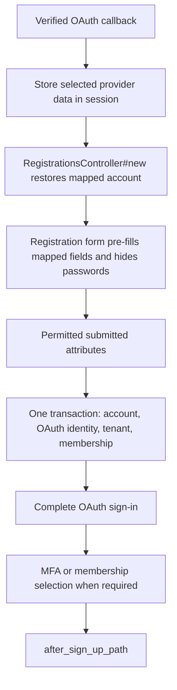

# Registration

## Contents

- [Standard registration](#standard-registration)
- [Accounts without passwords](#accounts-without-passwords)
- [Construct records transactionally](#construct-records-transactionally)
- [OAuth registration continuation](#oauth-registration-continuation)
- [Invitation registration](#invitation-registration)
- [Registration responses](#registration-responses)
- [Send people to onboarding](#send-people-to-onboarding)

## Standard registration

After the [standard setup](../README.md#install-and-generate-a-login), Vouch supplies `Users::RegistrationsController` and `app/views/users/registrations/new.html.erb`:

1. `GET /users/sign_up` builds an unsaved `User` and displays the form.
2. `POST /users/sign_up` assigns permitted fields and saves the record inside a transaction.
3. Invalid fields redisplay the form with errors and HTTP 422. Successful creation continues to sign-in or any required MFA.

In this guide, “account” means the model holding sign-in credentials; it can be `User`, `Account`, or another name. Add ordinary fields to the form and `account_params`; see [sign-in customization](sign-in-customization.md#customize-registration-fields).

## Accounts without passwords

Ordinary registration requires a chosen password. OAuth registration can instead save a verified provider identity in the same transaction, leaving `password_digest` null. An invitation may also create a pending account without either method; completing its registration still requires a usable sign-in method.

The generated model retains Rails password validations and makes only the absent-password case optional:

```ruby
# app/models/user.rb — relevant declarations from the generated model
class User < ApplicationRecord
  has_secure_password

  validate do
    errors.delete(:password, :blank) if password_digest.nil? && password.nil?
  end
end
```

Rails still checks password confirmation, BCrypt's byte limit and a supplied `password_challenge`. Registration rejects an explicitly submitted empty password; the OAuth form omits password fields entirely. Vouch separately checks the sign-in method when completing registration, rather than requiring a provider association before the account can be saved inside the transaction.

> Existing models keep their own validations. To support OAuth-only accounts or passwordless invitation placeholders, make the digest column nullable and use the optional-absence validation above after `has_secure_password`. Keep any stricter password rules your application requires. A null digest never authenticates a password.

For another verified registration method, the host can override `registration_authentication_available?(account, oauth:)` in its registration controller. Only return true after your registration flow has established the supported alternative; ordinary contact verification and MFA enrollment are not first-factor authentication.

## Construct records transactionally

For multi-tenant registration, Vouch saves records in this order inside one transaction:

1. Save the credential account.
2. Call `build_tenant(account)` and save the returned organisation.
3. Call `build_identity(account, tenant:)` and save the returned membership.

Return unsaved records from custom builders so Vouch controls persistence and rollback. The account passed to a builder, and the tenant passed to `build_identity`, have already been saved inside the open transaction; they are not yet committed. With one model, the default identity is the account itself, so no second record is created. GET registration does not invoke these builders.

All records requiring atomic persistence must share the credential model's writing database connection. A transaction cannot roll back writes to another database.

The generated tenant has no application-specific attributes. The following customization assumes you added a `name` column to `Organisation` and want to collect it during registration.

```ruby
# app/controllers/concerns/provisions_organisation.rb
module ProvisionsOrganisation
  extend ActiveSupport::Concern

  private

  def build_identity(account, tenant:)
    tenant.users.build(account: account)
  end
end
```

Move the generated controller's local `build_identity` method into this concern when adopting it; a local method otherwise takes precedence over an included concern. Include the same concern in registrations and, when using automatic OAuth registration, in the callback controller. This keeps construction consistent for ordinary registration, form OAuth continuation, and the explicit automatic OAuth opt-in:

```ruby
# app/controllers/accounts/registrations_controller.rb
class Accounts::RegistrationsController < Vouch::RegistrationsController
  include ProvisionsOrganisation

  private

  def build_tenant(_account)
    Organisation.new(params.require(:organisation).permit(:name))
  end
end

# app/controllers/accounts/omni_auths_controller.rb
class Accounts::OmniAuthsController < Vouch::OmniAuthsController
  include ProvisionsOrganisation

  private

  def build_tenant(account)
    Organisation.new(name: "#{account.email_address}'s organisation")
  end
end
```

Automatic registration has no submitted organisation form. The example above chooses a default name; use `registration: :form` when the person must choose it.

The registration form owns the tenant input. Keep it separate from account parameters:

```erb
<%# app/views/accounts/registrations/new.html.erb — inside the registration form %>
<% unless invitation_registration? %>
  <%= text_field_tag "organisation[name]", params.dig(:organisation, :name), required: true %>
<% end %>
```

For form OAuth registration, `RegistrationsController#create` restores the account attributes, assigns only permitted form fields, and then creates the account, OAuth identities, tenant, and membership in that transaction. A validation failure renders `app/views/accounts/registrations/new.html.erb` again with errors and no new persisted account/link. Provider and UID never come from form fields. See [multiple providers](oauth.md#connect-several-providers-during-registration) for separate proof expiry and reconnection.

## OAuth registration continuation

Configure OAuth callback registration with `:form` (the default) when a new provider identity needs fields that OAuth does not supply:

```ruby
# config/routes.rb, inside the credentials scope
auth.oauth_callbacks registration: :form
```

After an explicit OAuth registration request is verified, Vouch applies the provider data to the unsaved account and retains its attributes and provider proof in the session. `RegistrationsController#new` restores those values and pre-fills the form without applying the mapping again. No new account or provider link is saved yet. The generated form uses `oauth_registration?` to omit password fields while a valid provider proof supplies the sign-in method.

On submit, Vouch combines the mapped account fields with permitted form fields and creates the account and OAuth link in one transaction. In a multi-tenant setup, that transaction also includes the organisation and membership. It then continues through MFA and membership selection before redirecting. Validation failures re-render the form. Provider/UID data comes from protected session state, never submitted fields.

The default mapping uses the provider email when supplied and leaves the password absent. Add another mapped form value through the account model:

```ruby
# app/models/account.rb
class Account < ApplicationRecord
  def apply_oauth_registration(oauth_identity, auth_hash:)
    super
    self.name = auth_hash.info.name if name.blank?
  end
end
```



## Invitation registration

A new invitee completes the pending account and accepts the existing membership. Vouch reuses the invitation's organisation and does not call `build_tenant` or `build_identity`. The generated form shows the invited email as text, since registration cannot change the invitation recipient.

Use `invitation_registration?` to hide your tenant-creation fields, as shown above. Put work needed for both ordinary registration and new-invitee registration in a registration hook. Register the same callback for OAuth account creation when you offer OAuth:

```ruby
# app/controllers/accounts/registrations_controller.rb
class Accounts::RegistrationsController < Vouch::RegistrationsController
  after_sign_up :create_preferences
  after_oauth_account_creation :create_preferences

  private

  def create_preferences(account, *)
    Preferences.create!(account: account)
  end
end
```

> `Preferences` is an example application model. For automatic OAuth registration, add the same declarations and method to the OAuth controller or share them in a concern. Each callback runs inside the registration transaction; a failed write rolls back the account completion and invitation acceptance together. An existing account accepting another membership does not register again; use an invitation-acceptance hook for work needed on every accepted invitation.

## Registration responses

Vouch commits the account and related records before signing the person in. If that sign-in fails, the records remain saved: Vouch sends the person to sign-in with “Account created.” and “Something went wrong signing in, please try again.” Required MFA and membership selection continue to their respective pages instead.

Validation failures and cancelled creation roll back the registration and redisplay the form. Unexpected exceptions still reach Rails error handling.

Override `create` and pass a block to `super` to handle the outcome yourself:

```ruby
# app/controllers/users/registrations_controller.rb
class Users::RegistrationsController < Vouch::RegistrationsController
  def create
    super do |result|
      if result.invalid? && result.metadata[:committed]
        flash[:notice] = "Your account is ready."
        redirect_to new_user_session_path, alert: "Please sign in to continue."
      end
    end
  end
end
```

The block receives `ok`, `pending`, `invalid`, or `cancelled` results. A pending result identifies `:two_factor` or `:selection` in `metadata[:next_step]`. `metadata[:committed]` tells you whether registration was saved, and `result.error` carries an expected failure exception when available. Vouch uses its normal response unless the block renders or redirects. The same `create` override handles ordinary registration and an OAuth registration form submission.

## Send people to onboarding

After registration succeeds, choose where the person goes next. A shared redirect preserves the destination when signup finishes through an MFA controller:

```ruby
# app/controllers/application_controller.rb
class ApplicationController < ActionController::Base
  protected

  def after_sign_up_path_for(record, scope:)
    onboarding_path
  end
end
```

`onboarding_path` is a page you create for any remaining introduction or profile steps. Put required database work in a transactional hook and external work such as a welcome email in `after_commit_of_sign_up` and, when OAuth registration is enabled, `after_commit_of_oauth_account_creation`; see [lifecycle hooks](sessions-and-hooks.md#lifecycle-hooks).
