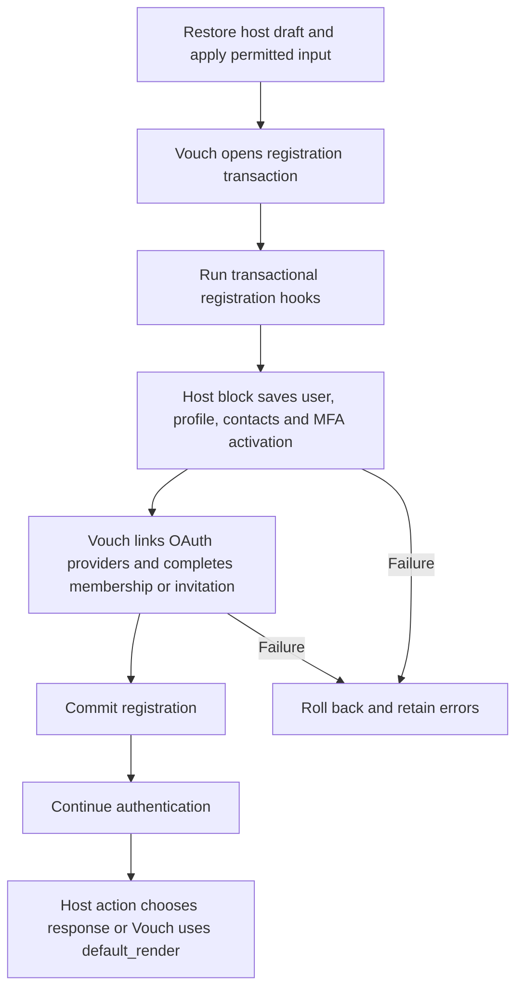
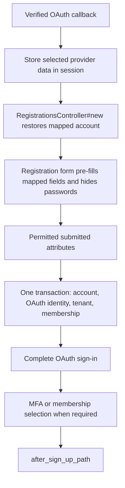

# Registration

## Contents

- [Standard registration](#standard-registration)
- [Custom registration forms](#custom-registration-forms)
- [Accounts without passwords](#accounts-without-passwords)
- [Construct records transactionally](#construct-records-transactionally)
- [OAuth registration continuation](#oauth-registration-continuation)
- [Invitation registration](#invitation-registration)
- [Registration responses](#registration-responses)
- [Send people to onboarding](#send-people-to-onboarding)

## Standard registration

After the [standard setup](../README.md#install-and-generate-a-login), Vouch supplies `Users::RegistrationsController` and `app/views/users/registrations/new.html.erb`:

1. `GET /users/sign_up` builds an unsaved `User` and displays the form.
2. `POST /users/sign_up` assigns permitted fields and saves the record inside a transaction.
3. Invalid fields redisplay the form with errors and HTTP 422. Successful creation continues to sign-in or any required MFA.

In this guide, “account” means the model holding sign-in credentials; it can be `User`, `Account`, or another name. Add ordinary fields to the form and `account_params`; see [sign-in customization](sign-in-customization.md#customize-registration-fields).

## Custom registration forms

Override `create` when you want a form object or want to save associated records yourself. Vouch prepares `@user` before the action. The block passed to `super` receives that same record and runs inside the registration transaction:

```ruby
# app/controllers/users/registrations_controller.rb
class Users::RegistrationsController < Vouch::RegistrationsController
  def create
    status = super do |user|
      @signup = SignupForm.new(user)
      @signup.assign_attributes(params.require(:signup).permit(
        :email_address, :password, :password_confirmation, :timezone
      ))
      @signup.save!
    end

    redirect_to welcome_path if status == :ok
  end
end
```

> `SignupForm` and `welcome_path` belong to your application. Vouch has no form-class declaration and does not construct, validate, serialize or save your form for you. The complete example below defines a form and its session handling.

The block replaces Vouch's default save. Save the supplied record, then any related records; Vouch does not save it a second time. Returning `false` cancels and rolls back. A successful bang save may return `nil`. Validation exceptions roll back and remain available as `@operation_error`; your form retains its own `errors`.

After the block, Vouch completes provider linking or invitation acceptance, constructs any mapped membership, and commits. It then attempts sign-in. Use the returned status and `@registration_committed` to decide the response. Without a render or redirect, Vouch sends its usual response after your action returns.

### Keep every step at the same URL

The following example collects profile details, verified contacts and a final password at `/users/sign_up`. Intermediate submissions render the next Turbo frame without creating database records. The final submission saves everything together.

It assumes these application associations exist:

```ruby
# app/models/user.rb — alongside the generated authentication declarations
class User < ApplicationRecord
  has_one :profile, inverse_of: :user
  has_many :phones, inverse_of: :user
  has_many :emails, inverse_of: :user
end

# app/models/profile.rb
class Profile < ApplicationRecord
  belongs_to :user
  validates :timezone, presence: true
end
```

`Profile` has a `timezone` field. `Phone` and `Email` use the [verification](verification.md) features, with `e164` and `email_address` as their respective subjects. Add [MFA support](mfa.md) if the form will enable them as authenticators.

```ruby
# app/forms/signup_form.rb
class SignupForm
  include ActiveModel::Model
  include ActiveModel::Attributes

  attr_reader :user, :profile, :phones, :emails, :contact_states, :unavailable_contacts
  attribute :enable_mfa, :boolean, default: false
  attribute :step, :integer, default: 1

  delegate :email_address, :email_address=, :password, :password=,
    :password_confirmation, :password_confirmation=, to: :user
  delegate :timezone, :timezone=, to: :profile

  validate do
    errors.add(:contacts, "must be verified again or removed") if unavailable_contacts.any?
    if enable_mfa && phones.empty? && emails.empty?
      errors.add(:enable_mfa, "requires a verified contact")
    end
    errors.add(:timezone, "cannot be blank") if timezone.blank?
  end

  def initialize(user)
    super()
    @user = user
    @profile = user.profile || user.build_profile
    @phones = []
    @emails = []
    @contact_states = { "phones" => {}, "emails" => {} }
    @unavailable_contacts = []
  end

  def self.deserialize(data, user)
    data ||= {}
    form = new(user)
    # An invitation's existing recipient is not editable.
    form.email_address = data["email_address"] if user.new_record? && data.key?("email_address")
    form.timezone = data["timezone"]
    form.enable_mfa = data["enable_mfa"]
    form.step = data.fetch("step", 1)
    { "phones" => Phone, "emails" => Email }.each do |key, model|
      states = data.fetch("contact_states", {}).fetch(key, {})
      form.contact_states[key] = states.deep_dup
      states.each do |subject, state|
        contact = model.new
        if contact.restore_verification_state(state).ok? && contact.verified? &&
            contact.verification_subject_key == subject
          form.public_send(key) << contact
        else
          form.unavailable_contacts << [key, subject]
        end
      end
    end
    form
  end

  def serialize
    {
      "email_address" => email_address,
      "timezone" => timezone,
      "enable_mfa" => enable_mfa,
      "step" => step,
      "contact_states" => contact_states.deep_dup
    }
  end

  def remove_contact(kind, subject)
    contact_states.fetch(kind).delete(subject)
    public_send(kind).reject! { |contact| contact.verification_subject_key == subject }
    unavailable_contacts.delete([kind, subject])
  end

  def save!
    raise ActiveModel::ValidationError.new(self) unless valid?

    user.save!
    profile.save!
    (phones + emails).each do |contact|
      contact.user = user
      contact.save!
      contact.enable_two_factor! if enable_mfa
    end
    user.enable_two_factor! if enable_mfa
  end
end
```

The form validates all required fields on final submission, regardless of the displayed step. It never serializes passwords or submitted verification codes. Expired proofs remain in the draft and block completion. A fresh verification replaces the entry for that subject; removing it explicitly clears that entry. The form does not silently drop a previously selected contact or retain a permanent error flag after it has been re-verified.

In this example, saved form values take precedence over OAuth-prefilled fields. Omit that assignment or make it conditional if provider data should take precedence instead. The form wraps Vouch's record; it does not create a replacement `User`.

```ruby
# app/controllers/users/registrations_controller.rb
class Users::RegistrationsController < Vouch::RegistrationsController
  before_action :set_signup, only: [:new, :create]

  def create
    @signup.assign_attributes(signup_params)

    if params[:remove_contact].present?
      kind, subject = params.require(:remove_contact).permit(:phones, :emails).to_h.first
      return head :bad_request unless kind

      @signup.remove_contact(kind, subject)
      session[:signup] = @signup.serialize
      return render :new
    end

    if ["details", "contacts"].include?(params[:advance])
      @signup.step = params[:advance] == "details" ? 1 : 2
      session[:signup] = @signup.serialize
      return render :new
    end

    session[:signup] = @signup.serialize
    status = super do |_user|
      @signup.save!
    end
    session.delete(:signup) if @registration_committed

    redirect_to root_path, status: :see_other if status == :ok
  end

  private

  def set_signup
    @signup = SignupForm.deserialize(session[:signup], @user)
  end

  def signup_params
    allowed = [:timezone, :password, :password_confirmation, :enable_mfa]
    allowed << :email_address unless invitation_registration?
    params.fetch(:signup, ActionController::Parameters.new).permit(*allowed)
  end
end
```

The parent `before_action` prepares `@user` before `set_signup` and rejects an invalid OAuth context before that callback runs. For an invitation it is the pending recipient; for an OAuth continuation it contains the mapped provider fields. Validation failures, invalid invitations, required MFA and membership selection use the normal fallback because this override only redirects a completed sign-in. The session retains `timezone` and the first-step email; the final form does not need hidden copies of them.

```erb
<%# app/views/users/registrations/new.html.erb %>
<%= turbo_frame_tag "signup" do %>
  <% (@signup.errors.full_messages + @user.errors.full_messages).uniq.each do |message| %>
    <p role="alert"><%= message %></p>
  <% end %>

  <% @signup.unavailable_contacts.each do |kind, subject| %>
    <p><%= JSON.parse(subject).join(", ") %> must be verified again or removed.</p>
    <%= button_to "Remove contact", user_registration_path,
          params: { remove_contact: { kind => subject } },
          form: { data: { turbo_frame: "signup" } } %>
  <% end %>

  <%= form_with model: @signup, scope: :signup, url: user_registration_path,
        data: { turbo_frame: @signup.step == 1 ? "signup" : "_top" } do |form| %>
    <% if @signup.step == 1 %>
      <%= form.email_field :email_address unless invitation_registration? %>
      <%= form.text_field :timezone %>
      <%= form.button "Continue", name: :advance, value: "contacts" %>
    <% else %>
      <p><%= @signup.phones.size %> phones and <%= @signup.emails.size %> emails verified</p>
      <%= form.check_box :enable_mfa %>
      <%= form.label :enable_mfa, "Require a second factor when signing in" %>
      <% unless oauth_registration? %>
        <%= form.password_field :password %>
        <%= form.password_field :password_confirmation %>
      <% end %>
      <%= form.button "Back", name: :advance, value: "details",
            data: { turbo_frame: "signup" } %>
      <%= form.submit "Create account" %>
    <% end %>
  <% end %>
<% end %>
```

The existing registration route handles both steps; no step routes are needed. The second-step form targets the full page so sign-in and MFA redirects can leave the frame. The Back button targets the frame again. See [Turbo frame navigation](https://turbo.hotwired.dev/reference/frames#targeting-navigation-into-or-out-of-a-frame).

> This is a session draft owned by your application. Choose its expiry, restart/removal behavior and whether separate browser tabs share it. Encrypted contact proofs and OAuth continuations keep their own expiry. Several encrypted contact records can exceed CookieStore's capacity; bound the draft or use a suitable server-side session store.

### Add verified contacts to the draft

Use the [temporary verification controller](verification.md#verify-before-saving) to send and check codes without saving a contact. The example there supplies the required callbacks, rate limits, subject lookup and routes. For registration, adapt its success action to write verified state into the form draft. The following is only that adaptation: add the allowlisted record preparation, authoritative saved-record lookup, rate limits and routes from the verification guide. Replace its signed-in guard with the unsigned-user guard shown here:

```ruby
# app/controllers/signup_verifications_controller.rb
class SignupVerificationsController < Vouch::TemporaryVerificationsController
  # Add the preparation and rate-limit callbacks shown in the verification guide.
  # Allow only Phone and Email; set @existing_verifiable using your uniqueness rules.
  before_action :require_unsigned_user

  def update
    status = super
    return unless status == :ok

    draft = (session[:signup] || {}).deep_dup
    key = { "phone" => "phones", "email" => "emails" }.fetch(params[:kind])
    draft["contact_states"] ||= {}
    draft["contact_states"][key] ||= {}
    draft["contact_states"][key][@verifiable.verification_subject_key] =
      @verifiable.serialize_verification_state
    session[:signup] = draft
    forget_temporary_verification
    redirect_to new_user_registration_path, status: :see_other
  end

  private

  def require_unsigned_user
    head :forbidden if user_signed_in?
  end
end
```

This action runs after Vouch has checked the code and retained the updated verification state. Only remove that state after your draft accepts it. A re-verified contact replaces the old entry with the same model kind and normalized subject. Other expired entries remain visible until they are re-verified or removed. Registration verification establishes control of a contact; it does not count as sign-in MFA evidence.

### Include authenticator apps

TOTP enrollment needs your credential adapter and enrollment UI; Vouch does not generate those. Follow the [TOTP adapter contract](credential-adapter-contract.md), confirm an enrollment code, then retain trusted encrypted enrollment state in your draft. Do not put a plaintext TOTP secret into a serialized form.

When your `TotpAuthenticator` implements the verification-state contract, add its state bucket, restored collection and permitted enrollment selection alongside `Phone` and `Email`. Include that collection when validating whether a selected MFA factor exists. Save it and enable it in the same `save!` method:

```ruby
# app/forms/signup_form.rb — inside save!, after user.save!
@authenticators.each do |authenticator|
  authenticator.user = user
  authenticator.save!
  authenticator.enable_two_factor!
end
```

> `TotpAuthenticator` and `@authenticators` are additions your application implements. Confirming enrollment must produce trusted state through your adapter; setting `verified_at` from submitted input is not verification. The generic code-delivery controller is not a TOTP enrollment endpoint.

### Continue through OAuth

Save permitted intermediate form fields to your own session draft before starting an OAuth registration request. Vouch separately stores verified provider proof. On return, `set_signup` restores your draft around the provider-prefilled `@user`; there is no automatic synchronization of an independent form object.

A form can submit an explicit “save and connect” branch to the same `create` action. That branch saves `@signup.serialize` and renders a provider button, which starts the [OAuth registration request](oauth.md#choose-registration-behavior). Do not call registration `super` until the person chooses to finish.

For automatic OAuth registration, put your form save in the callback's [persistence block](oauth.md#customize-automatic-registration). Vouch calls that block only when creating a new account automatically, not for sign-in, linking, or a redirect to the registration form.

### Finish in one transaction



All participating records must use the credentials model's writing connection. Enable selected MFA credentials inside this transaction, after saving their owner and the credentials. An enabled credential and an account requirement are separate settings; see [MFA activation](mfa.md).

For a multi-tenant application, keep `build_tenant` and `build_identity` for the mapped organisation and membership. The form can hold their input or constructed records, and the builders can return those records. Do not independently create a second tenant in the form. Invited registration uses the existing membership and skips these builders.

If registration commits but sign-in fails afterward, `@registration_committed` stays true. Clear the draft and direct the person to sign-in; creating their records again would duplicate completed work.

## Accounts without passwords

Ordinary registration requires a chosen password. OAuth registration can instead save a verified provider identity in the same transaction, leaving `password_digest` null. An invitation may also create a pending account without either method; completing its registration still requires a usable sign-in method.

The generated model retains Rails password validations and makes only the absent-password case optional:

```ruby
# app/models/user.rb — relevant declarations from the generated model
class User < ApplicationRecord
  has_secure_password

  validate do
    errors.delete(:password, :blank) if password_digest.nil? && password.nil?
  end
end
```

Rails still checks password confirmation, BCrypt's byte limit and a supplied `password_challenge`. Registration rejects an explicitly submitted empty password; the OAuth form omits password fields entirely. Vouch separately checks the sign-in method when completing registration, rather than requiring a provider association before the account can be saved inside the transaction.

> Existing models keep their own validations. To support OAuth-only accounts or passwordless invitation placeholders, make the digest column nullable and use the optional-absence validation above after `has_secure_password`. Keep any stricter password rules your application requires. A null digest never authenticates a password.

For another verified registration method, the host can override `registration_authentication_available?(account, oauth:)` in its registration controller. Only return true after your registration flow has established the supported alternative; ordinary contact verification and MFA enrollment are not first-factor authentication.

## Construct records transactionally

For multi-tenant registration, Vouch saves records in this order inside one transaction:

1. Save the credential account.
2. Call `build_tenant(account)` and save the returned organisation.
3. Call `build_identity(account, tenant:)` and save the returned membership.

Return unsaved records from custom builders so Vouch controls persistence and rollback. The account passed to a builder, and the tenant passed to `build_identity`, have already been saved inside the open transaction; they are not yet committed. With one model, the default identity is the account itself, so no second record is created. GET registration does not invoke these builders.

All records requiring atomic persistence must share the credential model's writing database connection. A transaction cannot roll back writes to another database.

The generated tenant has no application-specific attributes. The following customization assumes you added a `name` column to `Organisation` and want to collect it during registration.

```ruby
# app/controllers/concerns/provisions_organisation.rb
module ProvisionsOrganisation
  extend ActiveSupport::Concern

  private

  def build_identity(account, tenant:)
    tenant.users.build(account: account)
  end
end
```

Move the generated controller's local `build_identity` method into this concern when adopting it; a local method otherwise takes precedence over an included concern. Include the same concern in registrations and, when using automatic OAuth registration, in the callback controller. This keeps construction consistent for ordinary registration, form OAuth continuation, and the explicit automatic OAuth opt-in:

```ruby
# app/controllers/accounts/registrations_controller.rb
class Accounts::RegistrationsController < Vouch::RegistrationsController
  include ProvisionsOrganisation

  private

  def build_tenant(_account)
    Organisation.new(params.require(:organisation).permit(:name))
  end
end

# app/controllers/accounts/omni_auths_controller.rb
class Accounts::OmniAuthsController < Vouch::OmniAuthsController
  include ProvisionsOrganisation

  private

  def build_tenant(account)
    Organisation.new(name: "#{account.email_address}'s organisation")
  end
end
```

Automatic registration has no submitted organisation form. The example above chooses a default name; use `registration: :form` when the person must choose it.

The registration form owns the tenant input. Keep it separate from account parameters:

```erb
<%# app/views/accounts/registrations/new.html.erb — inside the registration form %>
<% unless invitation_registration? %>
  <%= text_field_tag "organisation[name]", params.dig(:organisation, :name), required: true %>
<% end %>
```

For form OAuth registration, `RegistrationsController#create` restores the account attributes, assigns only permitted form fields, and then creates the account, OAuth identities, tenant, and membership in that transaction. A validation failure renders `app/views/accounts/registrations/new.html.erb` again with errors and no new persisted account/link. Provider and UID never come from form fields. See [multiple providers](oauth.md#connect-several-providers-during-registration) for separate proof expiry and reconnection.

## OAuth registration continuation

Configure OAuth callback registration with `:form` (the default) when a new provider identity needs fields that OAuth does not supply:

```ruby
# config/routes.rb, inside the credentials scope
auth.oauth_callbacks registration: :form
```

After an explicit OAuth registration request is verified, Vouch applies the provider data to the unsaved account and retains its attributes and provider proof in the session. The registration controller's preparation callback restores those values and pre-fills the form without applying the mapping again. No new account or provider link is saved yet. The generated form uses `oauth_registration?` to omit password fields while a valid provider proof supplies the sign-in method.

On submit, Vouch combines the mapped account fields with permitted form fields and creates the account and OAuth link in one transaction. In a multi-tenant setup, that transaction also includes the organisation and membership. It then continues through MFA and membership selection before redirecting. Validation failures re-render the form. Provider/UID data comes from protected session state, never submitted fields.

The default mapping uses the provider email when supplied and leaves the password absent. Add another mapped form value through the account model:

```ruby
# app/models/account.rb
class Account < ApplicationRecord
  def apply_oauth_registration(oauth_identity, auth_hash:)
    super
    self.name = auth_hash.info.name if name.blank?
  end
end
```



## Invitation registration

A new invitee completes the pending account and accepts the existing membership. Vouch reuses the invitation's organisation and does not call `build_tenant` or `build_identity`. The generated form shows the invited email as text, since registration cannot change the invitation recipient.

Use `invitation_registration?` to hide your tenant-creation fields, as shown above. Put work needed for both ordinary registration and new-invitee registration in a registration hook. Register the same callback for OAuth account creation when you offer OAuth:

```ruby
# app/controllers/accounts/registrations_controller.rb
class Accounts::RegistrationsController < Vouch::RegistrationsController
  after_sign_up :create_preferences
  after_oauth_account_creation :create_preferences

  private

  def create_preferences(account, *)
    Preferences.create!(account: account)
  end
end
```

> `Preferences` is an example application model. For automatic OAuth registration, add the same declarations and method to the OAuth controller or share them in a concern. Each callback runs inside the registration transaction; a failed write rolls back the account completion and invitation acceptance together. An existing account accepting another membership does not register again; use an invitation-acceptance hook for work needed on every accepted invitation.

## Registration responses

Vouch commits the account and related records before signing the person in. If that sign-in fails, the records remain saved: Vouch sends the person to sign-in with “Account created.” and “Something went wrong signing in, please try again.” Required MFA and membership selection continue to their respective pages instead.

Validation failures and cancelled creation roll back the registration and redisplay the form. Unexpected exceptions still reach Rails error handling.

Call `super`, then use the returned status to handle the response yourself:

```ruby
# app/controllers/users/registrations_controller.rb
class Users::RegistrationsController < Vouch::RegistrationsController
  def create
    status = super
    if status == :invalid && @registration_committed
      flash[:notice] = "Your account is ready."
      redirect_to new_user_session_path, alert: "Please sign in to continue."
    end
  end
end
```

The action returns `:ok`, `:pending`, `:invalid`, or `:cancelled`. `@next_step` identifies a pending `:two_factor` or `:selection` step. `@registration_committed` distinguishes saved registration from rolled-back creation; `@operation_error` carries an expected failure exception when available. Vouch's `default_render` runs only if your action finishes without a response. The block form of `super` is for saving records, not for handling the response.

## Send people to onboarding

After registration succeeds, choose where the person goes next. A shared redirect preserves the destination when signup finishes through an MFA controller:

```ruby
# app/controllers/application_controller.rb
class ApplicationController < ActionController::Base
  protected

  def after_sign_up_path_for(record, scope:)
    onboarding_path
  end
end
```

`onboarding_path` is a page you create for any remaining introduction or profile steps. Put required database work in a transactional hook and external work such as a welcome email in `after_commit_of_sign_up` and, when OAuth registration is enabled, `after_commit_of_oauth_account_creation`; see [lifecycle hooks](sessions-and-hooks.md#lifecycle-hooks).
