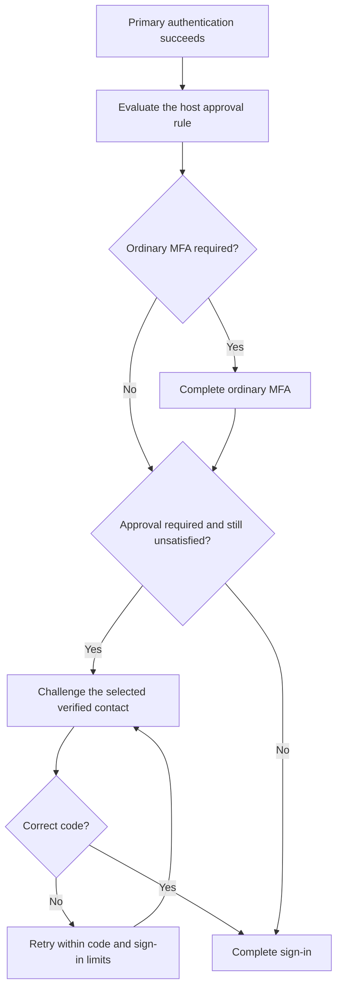

# Sign-in approval

Ask for extra proof on selected sign-ins, such as an unfamiliar device. Your application decides when approval is needed and which verified contact to challenge. Vouch sends the challenge through your delivery method and completes authentication after the required proof succeeds.

Approval uses the existing MFA pages. It can challenge a verified contact without enrolling that contact for ordinary MFA.

## Contents

- [Select a contact and require approval](#select-a-contact-and-require-approval)
- [How sign-in proceeds](#how-sign-in-proceeds)
- [Reuse an acceptable MFA proof](#reuse-an-acceptable-mfa-proof)
- [Record approvals and sign-ins](#record-approvals-and-sign-ins)
- [Customize the pages and handle failures](#customize-the-pages-and-handle-failures)
- [Accounts and memberships](#accounts-and-memberships)

## Select a contact and require approval

Start with the [MFA setup](mfa.md#add-phone-based-mfa) for your contact model. This example uses `User` and associated `Email` records. Each email must:

- Belong to the signing-in user through a configured MFA credential association.
- Be saved and verified.
- Include `Vouch::Verifiable` and `Vouch::TwoFactorable`, with their required columns.
- Implement `deliver_two_factor_code` through your email service.

Use the generated challenge controller, views, and `auth.two_factor_challenges` routes. Credential-management pages are optional for this flow.

The account's MFA preference and the contact's enrollment are separate:

| Setting | Meaning |
| --- | --- |
| `email.verified_at` | The address was verified. |
| `email.two_factor_enabled_at` | The email is enrolled as an ordinary MFA method. |
| `user.two_factor_enabled` | The user requires ordinary MFA during sign-in. |

Approval requires a verified contact, but neither MFA setting needs to be enabled. Completing approval leaves both settings unchanged.

Create a policy that selects the contact and decides when to request proof:

```ruby
# lib/application_authentication_policy.rb
class ApplicationAuthenticationPolicy < Vouch::AuthenticationPolicy
  def sign_in_approval_required?(user, controller:, **)
    !SignInRecognition.accepted?(user, request: controller.request)
  end

  def sign_in_approval_credential(user, **)
    user.recovery_email
  end
end
```

> `SignInRecognition` is a service you supply. It can compare devices, IP addresses, previous approvals, or several attributes together. `recovery_email` is your application's association selecting one email. Vouch supplies neither the recognition service nor approval-history tables.

Register the policy:

```ruby
# config/initializers/vouch.rb
require_relative "../../lib/application_authentication_policy"

Vouch.configure do |config|
  config.authentication_policy = ApplicationAuthenticationPolicy
end
```

The policy methods receive the same keywords as the [authentication policy](authentication-policy.md#block-suspended-users): `method:`, `provider:`, and `controller:`. The examples ignore unused keywords with `**`.

Vouch evaluates the requirement and selects the contact after primary authentication succeeds. It retains that selection in the pending Rails session. Later code submissions do not rerun device recognition or select another contact.

The selection method returns one credential or `nil`. Vouch checks its ownership, verification state, and challenge availability. A missing, unverified, foreign, or locked contact cannot complete required approval. The credential used for passwordless sign-in cannot provide its own additional proof.

Registration also uses authentication completion. If your rule requires approval after signup, the new account needs an eligible contact before sign-in can finish.

> Do not call `enable_two_factor!` to permit a one-time approval. That enrolls the contact for ordinary MFA. A model with only `Vouch::Verifiable` needs MFA challenge support before it can provide authentication proof.

## How sign-in proceeds

The same flow applies after password, OAuth, or another endpoint using Vouch's authentication completion API:



If ordinary MFA proves control of the selected contact, Vouch does not ask for another code. Otherwise, its next challenge page offers that contact.

Authentication remains pending until all requirements succeed. The [pending sign-in timeout](authentication-policy.md#pending-sign-in-timeout) covers the whole flow. Refreshing or moving between challenges does not extend it.

The contact must remain eligible throughout the flow. Changing its verified address, removing it, or changing its enrollment state invalidates the pending selection. Account credential changes and session invalidation also end the continuation.

## Reuse an acceptable MFA proof

By default, approval requires fresh proof from the exact selected contact. A TOTP proof from a different credential does not satisfy that requirement. Recovery codes also do not prove control of that contact.

To accept ordinary TOTP proof instead, add this override to the policy:

```ruby
# lib/application_authentication_policy.rb
class ApplicationAuthenticationPolicy < Vouch::AuthenticationPolicy
  def sign_in_approval_satisfied?(user, credential:, evidence:, **options)
    super || (
      evidence["method"] == "two_factor" &&
      evidence["credential_method"] == "totp"
    )
  end
end
```

Vouch calls this predicate for each current proof obtained during the pending sign-in. `credential:` is the contact selected for approval. `evidence:` describes the credential that supplied the proof. Existing session proof from an earlier sign-in is not imported into the new attempt.

| Situation | Challenges |
| --- | --- |
| No ordinary MFA, approval required | Selected contact. |
| Ordinary MFA uses the selected contact | One challenge satisfies both requirements. |
| Ordinary MFA uses TOTP and the override accepts it | TOTP only. |
| Ordinary MFA uses TOTP and exact email proof is required | TOTP, then the selected email. |
| Ordinary MFA is required but approval is unnecessary | Ordinary MFA still applies. |

Proof from an unenrolled contact includes `purpose: "sign_in_approval"` in [authentication evidence](authentication-policy.md#mfa-evidence-and-application-permissions). It does not satisfy ordinary MFA. Enrolled credentials use their existing challenge implementation and produce ordinary MFA evidence.

Recovery can complete ordinary MFA, but the default approval rule still requires the selected contact afterward. Applications that accept recovery proof for approval can explicitly accept `method == "recovery_code"` in this predicate. That does not prove access to the selected inbox or phone.

## Record approvals and sign-ins

Vouch stores authentication proof in the session. Your application decides whether to store a durable device approval or a sign-in history record.

Use the shared sign-in callback to record completed logins:

```ruby
# app/controllers/application_controller.rb
class ApplicationController < ActionController::Base
  include Vouch::ControllerHelpers

  after_commit_of_sign_in :record_sign_in

  private

  def record_sign_in(user, identity, *credentials, authentication_method:, **)
    SignInLog.record(
      user: user,
      identity: identity,
      method: authentication_method,
      request: request,
      evidence: authentication_evidence(scope: auth_scope_name)
    )
  end
end
```

> `SignInLog` is your application service. This example records a completed sign-in. It does not automatically trust a new device or location.

Use `on_two_factor_verification` when you need the accepted credential and proof:

```ruby
# app/controllers/application_controller.rb
class ApplicationController < ActionController::Base
  include Vouch::ControllerHelpers

  on_two_factor_verification :record_authentication_proof

  private

  def record_authentication_proof(user, identity, credential, evidence:, additional:)
    AuthenticationAudit.record(
      user: user,
      identity: identity,
      credential: credential,
      evidence: evidence,
      additional: additional
    )
  end
end
```

> `AuthenticationAudit` is another example application service. Recovery proof can have a nil `credential`.

During sign-in, Vouch emits this event for each retained proof after authentication completes, including any membership-selection step. A failed or abandoned sign-in emits no successful-authentication event. An additional MFA challenge after sign-in emits its event immediately after accepting the proof.

The callback request is the request that completed authentication. If approval depends on the original device or IP, retain those values in your own session entry. Decide explicitly which original values become trusted and when that approval expires. Accepting a known device in a new location must not automatically make that location trusted for other devices.

## Customize the pages and handle failures

Approval uses the generated MFA selector and code form. The selector displays the chosen contact. Your existing `deliver_two_factor_code` sends its code.

Normal Rails action overrides work here too. For example:

```ruby
# app/controllers/users/two_factor_challenge_controller.rb
class Users::TwoFactorChallengeController < Vouch::TwoFactorChallengeController
  def update
    status = super
    if status == :ok
      redirect_to projects_path, notice: "Sign-in complete."
    end
  end
end
```

The inherited response handles outcomes you do not override. `:pending` can mean another MFA challenge or membership selection. Inspect `@next_step` to distinguish them. See [controller responses](controllers.md) for rendering errors and other outcomes.

| Outcome | Default behavior |
| --- | --- |
| Incorrect code | Render the code form with an error and HTTP 422. |
| Contact locks, changes, or disappears | End the continuation and return to sign-in. |
| Sign-in expires or account credentials change | Return to sign-in. |
| No eligible contact when approval is required | Reject authentication through the initiating endpoint's normal failure response. |
| Cancel | Clear the pending challenge and return to sign-in. |

Unenrolled contacts use `sign_in_approval_challenge` and `verify_sign_in_approval(code, token:)`. Their bang variants raise `Vouch::OperationFailed` for unsuccessful results. These methods share MFA delivery, attempt limits, and lockout settings. Their tokens have a separate purpose, and issuing another code invalidates the previous code.

The default implementation delivers a code. Enrolled TOTP and hardware credentials use their existing `challenge` and `verify_challenge` overrides. Custom adapters that support approval while unenrolled can override the two approval methods too.

> A successful model-level challenge does not sign anyone in. The controller binds the proof to the pending authentication and completes the remaining requirements.

## Accounts and memberships

For a single-model application, the policy receives the signing-in `User`.

For a multi-tenant application, it receives the credentials model, such as `Account`. Select contacts through that model's associations. Approval completes before Vouch establishes the account session. Entering a linked membership does not repeat this account-level policy.

Organisation-specific access rules remain in your application's permissions code. Use the account's evidence and [additional MFA challenges](mfa.md#request-another-mfa-proof) when a protected page requires another authenticator. Vouch does not assume a tenant exists during account sign-in.
