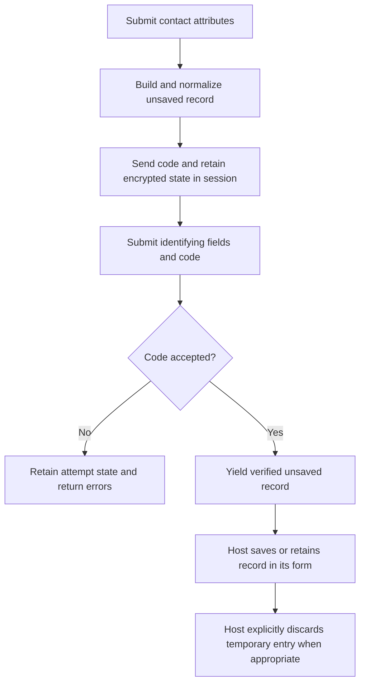

# Verify phones and email addresses

Verification confirms control of a contact address, such as a phone number or email inbox. It does not sign someone in or count as MFA. After verifying a contact, an application may separately [enable it as an MFA credential](mfa.md).

## Contents

- [Add code verification](#add-code-verification)
- [Verify an existing record](#verify-an-existing-record)
- [Verify before saving](#verify-before-saving)
- [Protect delivery and code submission](#protect-delivery-and-code-submission)
- [Retain verified records in a form](#retain-verified-records-in-a-form)
- [Use signed confirmation links](#use-signed-confirmation-links)
- [Results and customization](#results-and-customization)

## Add code verification

Assume your application has a `Phone` model with an `e164` attribute. Its associations are up to your application.

```sh
bin/rails generate vouch:verifiable Phone --subject e164
bin/rails db:migrate
```

The generator adds:

- Verification state, attempts and challenge storage to the existing table.
- `Vouch::Verifiable` and the subject declaration to the model.
- A `deliver_verification_code` method for your delivery integration.

It does not generate routes, controllers, views or an owner association. Existing subject declarations and delivery methods are preserved. Timestamps are not required for verification.

The generated migration adds these missing columns and index:

```ruby
change_table :phones do |t|
  t.string :verification_nonce
  t.datetime :verified_at, index: true
  t.bigint :verification_version, default: 0, null: false
  t.bigint :verification_attempts, default: 0, null: false
  t.datetime :verification_locked_at

end
```

Configure normalization and delivery in the model:

```ruby
# app/models/phone.rb
class Phone < ApplicationRecord
  include Vouch::Verifiable
  belongs_to :user

  self.verifiable_subject_attribute = :e164
  normalizes :e164, with: ->(value) { value.strip }
  validates :e164, presence: true

  def deliver_verification_code(code)
    SmsService.deliver(e164, "Your verification code is #{code}")
  end
end
```

> `SmsService` represents your application's SMS integration. Use your own phone normalization rules; stripping whitespace alone is not international phone-number normalization.

The subject declaration identifies the fields whose verification matters. Changing a subject field clears verification and outstanding verification/passwordless challenges. Assigning an equivalent normalized value preserves them. Unrelated profile edits do not revoke verification.

For a split email address, declare both fields:

```ruby
# app/models/email.rb
class Email < ApplicationRecord
  include Vouch::Verifiable

  self.verifiable_subject_attribute = [:name, :domain]
  normalizes :name, :domain, with: ->(value) { value.strip.downcase }

  def deliver_verification_code(code)
    ContactMailer.verification(self, code).deliver_later
  end
end
```

Each field remains a separate part of the subject. For example, `["ab", "c"]` and `["a", "bc"]` identify different addresses.

## Verify an existing record

Use `Vouch::VerificationsController` when the record is already saved. Your controller chooses its owner, loads the record and authorizes the action. Vouch supplies code issuance, checking and result handling.

```ruby
# config/routes.rb
Rails.application.routes.draw do
  scope "verification/:kind/:record_id" do
    resource :verification, path: "", only: [:create, :update]
  end
end
```

```ruby
# app/controllers/verifications_controller.rb
class VerificationsController < Vouch::VerificationsController
  RATE_STORE = Vouch::VerificationRateLimitStore.new(Rails.cache)

  before_action :authenticate_user!
  rate_limit to: 20, within: 10.minutes, only: :create,
    name: "delivery-ip", scope: "verification", store: RATE_STORE
  rate_limit to: 30, within: 10.minutes, only: :update,
    name: "code-ip", scope: "verification", store: RATE_STORE

  before_action :set_verifiable, only: [:create, :update]

  rate_limit to: 3, within: 10.minutes, only: :create,
    by: :verification_subject_key, name: "delivery-subject", scope: "verification", store: RATE_STORE
  rate_limit to: 5, within: 10.minutes, only: :update,
    by: :verification_subject_key, name: "code-subject", scope: "verification", store: RATE_STORE

  def create
    # Authorize sending a code to @verifiable here.
    super
  end

  def update
    # Authorize changing @verifiable here.
    super
  end

  private

  def set_verifiable
    @verifiable = case params[:kind]
    when "phone" then current_user.phones.find(params[:record_id])
    when "email" then current_user.emails.find(params[:record_id])
    else raise ActionController::RoutingError, "Not found"
    end
  end
end
```

| Request | Operation |
| --- | --- |
| `POST /verification/phone/42` | Send or resend the code for the authorized phone. |
| `PATCH /verification/phone/42`, with `code` | Check the code and save verification. |

The challenge token stays in the browser's session. The frontend submits the code, not an internal challenge token. The default response is JSON containing `status` and field `errors`; no verification form is supplied. Use the result block below for your own HTML, Turbo or JSON response.

> Configure a shared atomic cache before using the rate-limit examples. Their store and limits are explained [below](#protect-delivery-and-code-submission).

## Verify before saving

A temporary verification keeps an unsaved record in the session. Only after the correct code does your application decide whether to save it to a signed-in owner or retain it for registration.



Add the temporary endpoint alongside the existing-record endpoint:

```ruby
# config/routes.rb
Rails.application.routes.draw do
  scope "verification/:kind" do
    resource :temporary_verification, path: "", only: [:create, :update, :destroy]

    scope ":record_id" do
      resource :verification, path: "", only: [:create, :update]
    end
  end
end
```

This example verifies new phones for a signed-in user. `@existing_verifiable` is an authoritative lookup within that user's records; it prevents an old session challenge from verifying an already-saved, verified contact again. A registration flow must supply its own corresponding lookup rather than assuming global phone uniqueness.

```ruby
# app/controllers/temporary_verifications_controller.rb
class TemporaryVerificationsController < Vouch::TemporaryVerificationsController
  RATE_STORE = Vouch::VerificationRateLimitStore.new(Rails.cache)

  before_action :authenticate_user!
  rate_limit to: 20, within: 10.minutes, only: :create,
    name: "delivery-ip", scope: "verification", store: RATE_STORE
  rate_limit to: 30, within: 10.minutes, only: :update,
    name: "code-ip", scope: "verification", store: RATE_STORE

  before_action :build_verifiable, only: :create
  before_action :set_verifiable, only: [:update, :destroy]
  before_action :set_existing_verifiable, only: [:create, :update]

  rate_limit to: 3, within: 10.minutes, only: :create,
    by: :verification_subject_key, name: "delivery-subject", scope: "verification", store: RATE_STORE
  rate_limit to: 5, within: 10.minutes, only: :update,
    by: :verification_subject_key, name: "code-subject", scope: "verification", store: RATE_STORE

  def update
    # Authorize adding this phone to current_user here.
    super do |result|
      next unless result.ok?

      @verifiable.user = current_user
      if @verifiable.save
        forget_temporary_verification
        redirect_to edit_profile_path, notice: "Phone verified"
      else
        render json: { errors: @verifiable.errors.to_hash }, status: :unprocessable_entity
      end
    end
  end

  private

  def build_verifiable
    raise ActionController::RoutingError, "Not found" unless params[:kind] == "phone"
    @verifiable = current_user.phones.build(params.require(:phone).permit(:e164))
  end

  def set_verifiable
    build_verifiable
    @verifiable = restore_temporary_verification(@verifiable)
  end

  def set_existing_verifiable
    @existing_verifiable = current_user.phones.find_by(e164: @verifiable.e164)
  end
end
```

`POST /verification/phone` receives `phone[e164]`. `PATCH` receives the same identifying attributes and `code`; completion restores the original record rather than accepting replacement attributes. `DELETE` explicitly discards that temporary entry. Normalize through the same model in both requests. `:kind` is an allowlist, never an unrestricted class name.

The create action validates with the Rails `:verification` context. If registration verifies a contact before its owner exists, arrange your model validations to allow that context while still requiring ownership on persistence. Vouch does not remove association validations.

After checking a code, the updated state is retained before your result block runs, including unsuccessful attempts. A failed attachment therefore does not discard proof. Missing or expired temporary state produces a normal `ActiveRecord::RecordNotFound` boundary; handle it through Rails `rescue_from` if your frontend needs a restart response.

> Recheck duplicate/ownership rules when saving and use database constraints where your application requires uniqueness. A completion-time lookup alone cannot prevent two concurrent attachments. Do not attach another owner's record merely because its phone number matches.

> With cookie sessions, someone can replay an older authentic cookie until it expires. Updating the current session cannot globally revoke every older snapshot. The authoritative saved-record check prevents replay from becoming fresh verification after the contact has been saved and verified; it does not promise global single-use proof before persistence.

To replace the identifying fields of an existing authorized record, apply the temporary proof instead of copying `verified_at`:

```ruby
# app/controllers/temporary_verifications_controller.rb
class TemporaryVerificationsController < Vouch::TemporaryVerificationsController
  # Keep the preparation and rate-limit callbacks from the complete example above.
  def update
    target = current_user.phones.find(params.require(:replacement_id))
    # Authorize replacing target here.
    super do |result|
      next unless result.ok?

      applied = @verifiable.apply_verification_to(target)
      if applied.ok? || applied.already_verified?
        forget_temporary_verification
        redirect_to edit_profile_path, notice: "Phone updated"
      else
        render json: { errors: target.errors.to_hash }, status: :unprocessable_entity
      end
    end
  end
end
```

`apply_verification_to` requires an unexpired, verified temporary record and a saved record of the same model class. It copies only the declared identifying fields, revokes old challenges, and saves the replacement and verification together under a row lock. An already-verified identical subject returns `already_verified?` without refreshing proof. Your controller owns target authorization and duplicate rules.

## Protect delivery and code submission

Both controllers above use Rails' `rate_limit`. Matching `scope`, `name`, canonical model/subject and cache store share a budget across temporary and saved-record endpoints. New sessions and aliases for the same kind do not reset it.

| Budget | Example allowance | Purpose |
| --- | --- | --- |
| Delivery per subject | 3 per 10 minutes | Limit messages to one address. |
| Delivery per IP | 20 per 10 minutes | Limit messages across many addresses. |
| Submission per subject | 5 per 10 minutes | Limit guesses across sessions and IPs. |
| Submission per IP | 30 per 10 minutes | Limit guesses across many addresses. |

These allowances are examples. `to:` sets the count and `within:` its lifetime. Rails counts every request reaching a limiter, not just incorrect codes. Declare IP limits before record preparation and subject limits afterward. Keep delivery and submission names distinct. Add `with: :your_response_method` to customize a 429 response.

Use a shared atomic cache such as Redis or Memcached. `Vouch::VerificationRateLimitStore` delegates counting to that cache and rejects a missing/non-integer counter instead of silently allowing the request. The generic controllers return 503 when it reports an unavailable counter. MemoryStore and NullStore are rejected because their counters cannot protect multiple application processes. Custom cache stores must implement shared atomic `increment`; unrelated backend exceptions keep their original type.

## Retain verified records in a form

`serialize_verification_state` exports an unsaved credential into an authenticated encrypted string. `restore_verification_state` restores that record's attributes, subject/version, attempts and verification challenge. It preserves the original expiry, using `pending_authentication_ttl` for the temporary state's lifetime; serializing it again does not renew that deadline.

A form can store this string alongside its own permitted fields:

```ruby
# app/forms/phone_selection.rb
class PhoneSelection
  include ActiveModel::Model
  attr_accessor :phone

  def serialize
    { "phone" => phone.serialize_verification_state }
  end

  def self.deserialize(data)
    phone = Phone.new
    phone.restore_verification_state!(data.fetch("phone"))
    new(phone: phone)
  end
end
```

`PhoneSelection` above is a standalone form illustrating credential serialization. To retain verified contacts during registration, include the encrypted string in your registration form's serialized data and use the [custom registration form integration](registration.md#custom-registration-forms). A registered form receives the mapped credentials record as a positional argument to `.new(record)` or `.deserialize(data, record)`. Your form validates and saves its contacts; Vouch opens the registration transaction.

> Encrypted credential state still counts toward the session size. Several contacts and TOTP enrollment data can exceed CookieStore's limit and raise `ActionDispatch::Cookies::CookieOverflow`. Use a suitable server-side session store or bound the records your form retains; do not discard proof silently.

The envelope can preserve credential-specific enrollment attributes such as a TOTP secret, encrypted at rest in the serialized value. It excludes password values/digests, submitted OTP fields, authentication challenge nonces and MFA activation. A submitted `verified_at` does not manufacture proof. Enabling a verified factor belongs inside the final registration transaction after saving its owner and credential.

## Use signed confirmation links

Signed links verify saved records. Use your existing `Email` model; no separate confirmation table is required.

```sh
bin/rails generate vouch:token_verifiable Email --subject address
bin/rails db:migrate
```

The generator adds:

- `verified_at` and `confirmation_nonce` to the existing table.
- Their indexes.
- `Vouch::TokenVerifiable::Concern` and the subject declaration to the model.

It preserves an existing declaration and shared verification columns. It does not generate a mailer, controller, route or form.

```ruby
change_table :emails do |t|
  t.datetime :verified_at, index: true
  t.string :confirmation_nonce, index: { unique: true }

end
```

```ruby
# app/models/email.rb
class Email < ApplicationRecord
  include Vouch::TokenVerifiable::Concern
  belongs_to :user

  self.verifiable_subject_attribute = :address
  self.token_validity = 1.day
  normalizes :address, with: ->(value) { value.strip.downcase }
end
```

Send `email.confirmation_token` using your mailer. A link may open in another browser because its saved record is looked up from the signed token. Opening the link should display a confirmation; a modifying request consumes it.

```ruby
# config/routes.rb
Rails.application.routes.draw do
  resource :email_confirmation, only: [:show, :update]
end
```

```ruby
# app/controllers/email_confirmations_controller.rb
class EmailConfirmationsController < ApplicationController
  def show
    @token = params.require(:token)
  end

  def update
    result = Email.consume_token(params.require(:token))
    if result.ok? || result.already_verified?
      redirect_to root_path, notice: "Email confirmed"
    else
      redirect_to root_path, alert: "The confirmation link could not be accepted"
    end
  end
end
```

```erb
<%# app/views/email_confirmations/show.html.erb %>
<%= button_to "Confirm email", email_confirmation_path,
  method: :patch, params: { token: @token } %>
```

Code and signed-link verification share one subject declaration. Success clears sibling verification challenges; changing the address or calling `rotate_confirmation_nonce!` revokes an outstanding link. Temporary registration contacts must use code verification, not signed links.

## Results and customization

| Operation | Normal method | Bang method |
| --- | --- | --- |
| Send code | `start_verification` | `start_verification!` |
| Check code | `complete_verification(code)` | `complete_verification!(code)` |
| Revoke verification | `unverify` | `unverify!` |
| Apply a verified replacement | `apply_verification_to(record)` | `apply_verification_to!(record)` |
| Restore temporary state | `restore_verification_state(state)` | `restore_verification_state!(state)` |
| Consume signed link | `Email.consume_token(token)` | `Email.consume_token!(token)` |
| Revoke signed links | `rotate_confirmation_nonce` | `rotate_confirmation_nonce!` |

Normal methods return `Vouch::Result`. Bang methods return the same successful result and raise `Vouch::OperationFailed` for expected unsuccessful outcomes. `already_verified?` means verification was already saved for this subject; `ok?` is false because no fresh proof was accepted. A bang call also raises for that outcome. See [results and persistence](persistence.md).

Override a supplied controller action and call `super do |result|` to handle success, failure or already-verified state. Rendering or redirecting suppresses the default JSON response. Preparation only loads/builds records; delivery and mutation happen after your action's authorization.

For complete controller control:

```sh
bin/rails generate vouch:eject contacts verifications
bin/rails generate vouch:eject contacts temporary_verifications
```

These generic controllers do not use `auth_scope`. Ejecting the temporary controller retains its shared `Vouch::VerificationsController` superclass; eject that base as well and change the superclass if you also want to own its response/session helpers. See [controller ejection](controllers.md#eject-a-controller).
